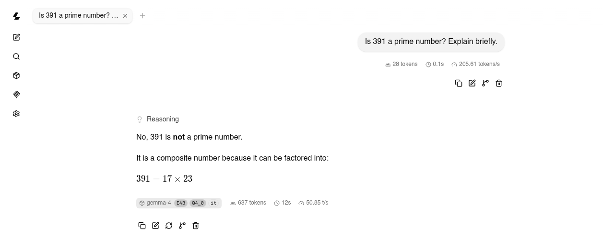
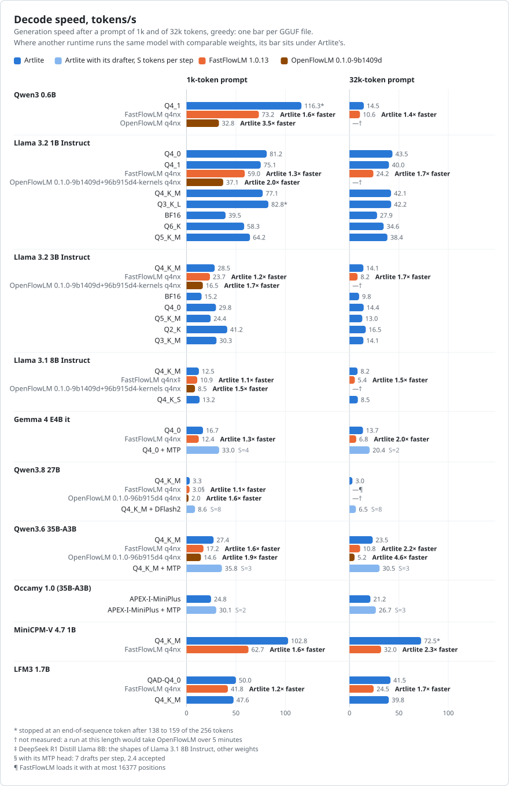
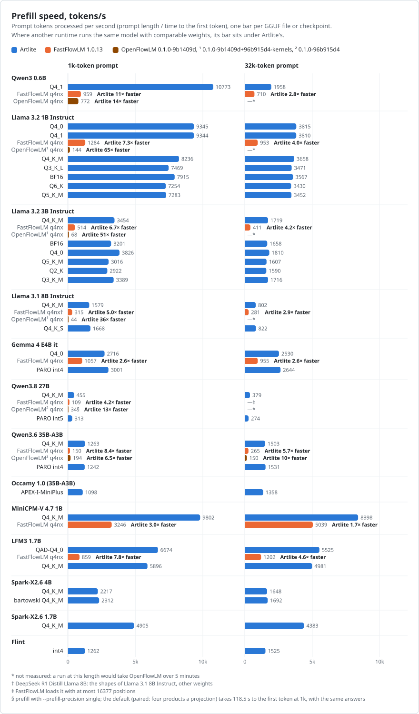
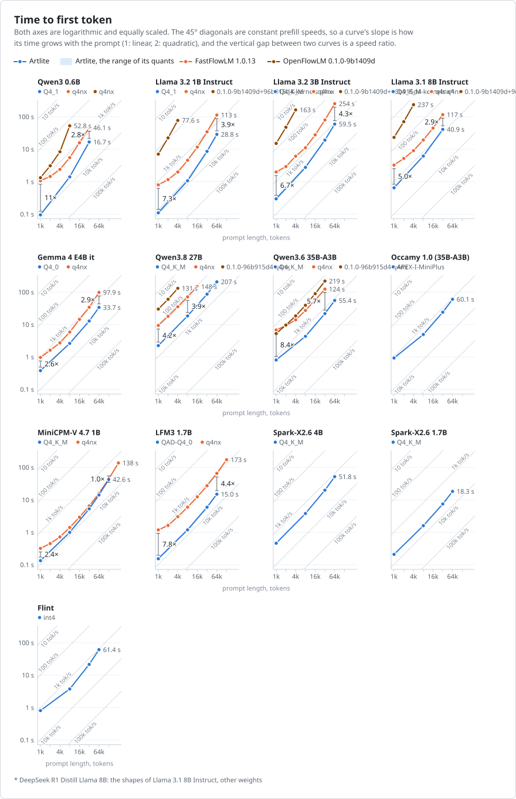
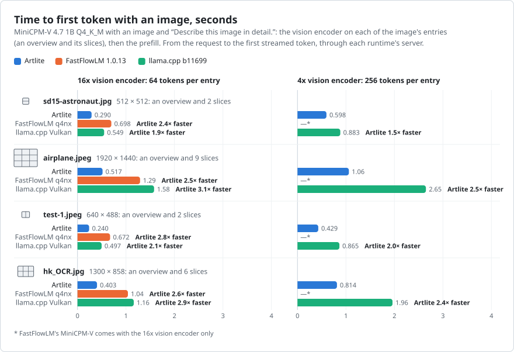
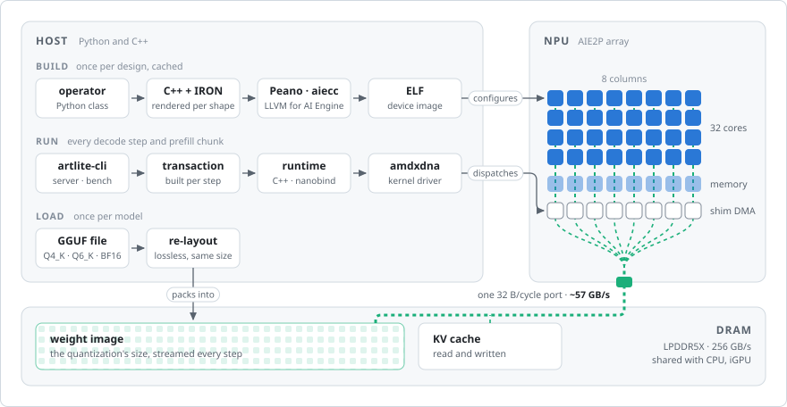

<p align="center">
  <picture>
    <source media="(prefers-color-scheme: dark)" srcset="docs/images/logo-dark.svg">
    
  </picture>
</p>

<p align="center">
  <b>The fastest inference engine for the NPU of AMD Ryzen AI processors</b>
</p>

<p align="center">
  <a href="LICENSE"></a>
  
  
  
</p>

Artlite runs language, vision and speech models and Stable Diffusion on the XDNA 2 NPU of AMD Strix Point, Krackan
Point and Strix Halo processors, and serves them to apps and coding agents.

- **Fast prompts and generation.** Artlite processes prompts 1.7-11x faster than FastFlowLM, the next fastest engine,
  and generates text 1.1-2.3x faster ([Performance](#performance)).
- **A local server for apps and agents.** OpenAI- and Anthropic-compatible APIs with tool calls, structured output, a
  prompt cache and several requests at a time. Claude Code, Codex and opencode work with it.
- **Text, images, video and speech.** Chat, questions about images and videos, transcripts with speakers, text to
  speech, voice conversations, embeddings and image generation.
- **Built for XDNA 2.** Artlite's own JIT toolchain generates every NPU kernel for the model's shapes and weight
  formats and compiles it at run time.

## Quick start

You need a Ryzen AI processor with an XDNA 2 NPU, Linux with the `amdxdna` driver, libdrm, CMake, a C++23 compiler and
[uv](https://docs.astral.sh/uv/). Windows 11, NixOS and the details are in [Installation](docs/install.md).

```bash
git clone https://github.com/artlite-project/artlite && cd artlite
uv venv && source .venv/bin/activate
uv sync --no-dev
```

Download a model into the models directory (`~/.artlite/models`, laid out as on Hugging Face) and run it:

```bash
uvx --from huggingface_hub hf download ggml-org/gemma-4-E4B-it-GGUF \
    gemma-4-E4B-it-Q4_0.gguf mtp-gemma-4-E4B-it-Q4_0.gguf --local-dir ~/.artlite/models/ggml-org/gemma-4-E4B-it-GGUF

M=ggml-org/gemma-4-E4B-it-GGUF/gemma-4-E4B-it-Q4_0.gguf
artlite-cli -m $M -p "Factorize x^2 + x - 6"     # answer in the terminal
artlite-server -m $M -rea on                     # API and web chat on http://127.0.0.1:8080
artlite-server                                   # every downloaded model, with a model picker
artlite-bench -m $M -p 1024,8192 -n 128          # prompt and generation speeds, as llama-bench
```

<picture>
  <source media="(prefers-color-scheme: dark)" srcset="docs/images/server-dark.png">
  
</picture>

## Documentation

| | |
|---|---|
| [Installation](docs/install.md) | hardware, driver, build on Linux, Windows 11 and NixOS, troubleshooting |
| [artlite-cli](docs/cli.md) | text, images and transcripts from the command line |
| [artlite-server](docs/server.md) | the API server and web chat, [coding agents](docs/server.md#agents) |
| [artlite-bench](docs/bench.md), [artlite-probe](docs/probe.md) | prompt and generation speeds; the NPU's clock and memory rates |
| [Models](docs/models/README.md) | supported models and files, how each model runs on the NPU |
| [Benchmark methodology](docs/methodology.md) | how the charts are measured |
| [Where the NPU fits](docs/npu-vs-igpu.md) | the NPU vs. the iGPU: memory bandwidth, power, workloads |
| [Design](docs/design.md), [Development](docs/development.md) | how Artlite works; tests, operators and kernel tools |

All pages: [docs/](docs/README.md).

## Models

| model | what it does |
|---|---|
| [Llama 3.2 1B, 3B, Llama 3.1 8B](docs/models/llama3.md) | text |
| [Qwen3 0.6B, Qwen3-Embedding, Qwen3-Reranker](docs/models/qwen3.md) | text, embeddings, rerank, decisions |
| [Gemma 4 E4B](docs/models/gemma4.md) | text |
| [Qwen3.5 9B, Qwen3.6 27B, Qwen3.8 27B, Qwen3.6 35B-A3B, MiniCPM-V 4.7](docs/models/qwen35.md) | text, images, decisions |
| [LFM3 1.7B, LFM3-VL, LFM3-Audio, LFM3-Omni](docs/models/lfm3.md) | text, images, video, speech in and out, decisions |
| [Spark-X2.6 4B, 1.7B](docs/models/spark.md) | text |
| [Flint](docs/models/flint.md) | text |
| [Inkling 2 Mini](docs/models/inkling2.md) | text, images |
| [MOSS-Transcribe-Diarize](docs/models/moss.md) | transcripts with timestamps and speakers |
| [Stable Diffusion 1.5](docs/models/sd15.md) | image generation |

Artlite loads GGUF files, Hugging Face checkpoints and ParoQuant checkpoints. The tested files of each model and the
planned models are listed in [Models](docs/models/README.md).

## Performance

How these are measured: [Benchmark methodology](docs/methodology.md).

<picture>
  <source media="(prefers-color-scheme: dark)" srcset="docs/images/decode-dark.svg">
  
</picture>

<picture>
  <source media="(prefers-color-scheme: dark)" srcset="docs/images/prefill-dark.svg">
  
</picture>

<picture>
  <source media="(prefers-color-scheme: dark)" srcset="docs/images/ttft-dark.svg">
  
</picture>

<picture>
  <source media="(prefers-color-scheme: dark)" srcset="docs/images/image-ttft-dark.svg">
  
</picture>

## How it works

<picture>
  <source media="(prefers-color-scheme: dark)" srcset="docs/images/how-it-works-dark.svg">
  
</picture>

Each operator renders a C++ kernel and an IRON design of the array's data movement for its shapes. Peano (LLVM for AI
Engine) and aiecc compile them once into the ELF that configures the array, and the build cache keeps the result. At
load, the weights are packed into one buffer in DRAM. For every step the host builds a transaction and dispatches it to the
NPU through the `amdxdna` driver (through XRT on Windows). A decode step runs on an overlay design whose cores read
their work from that transaction, and a prompt runs as chunk programs assembled from a library of compiled designs.
Details: [Design](docs/design.md).
