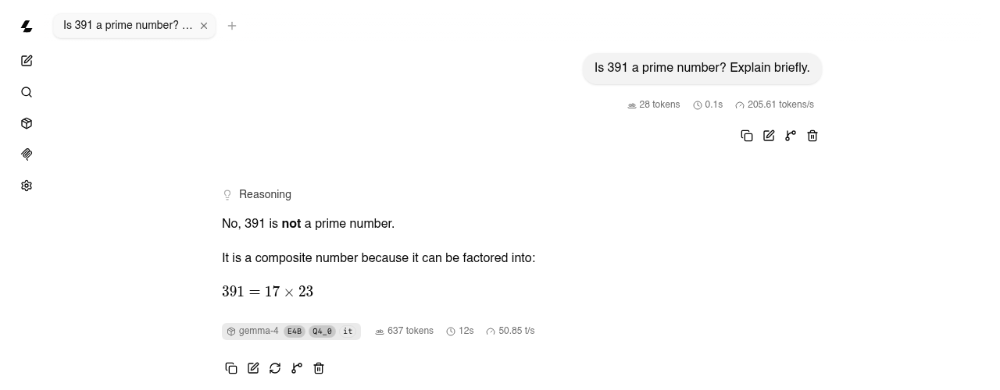
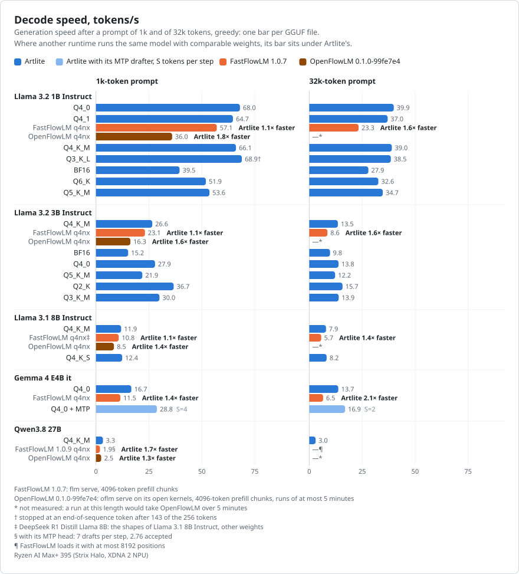
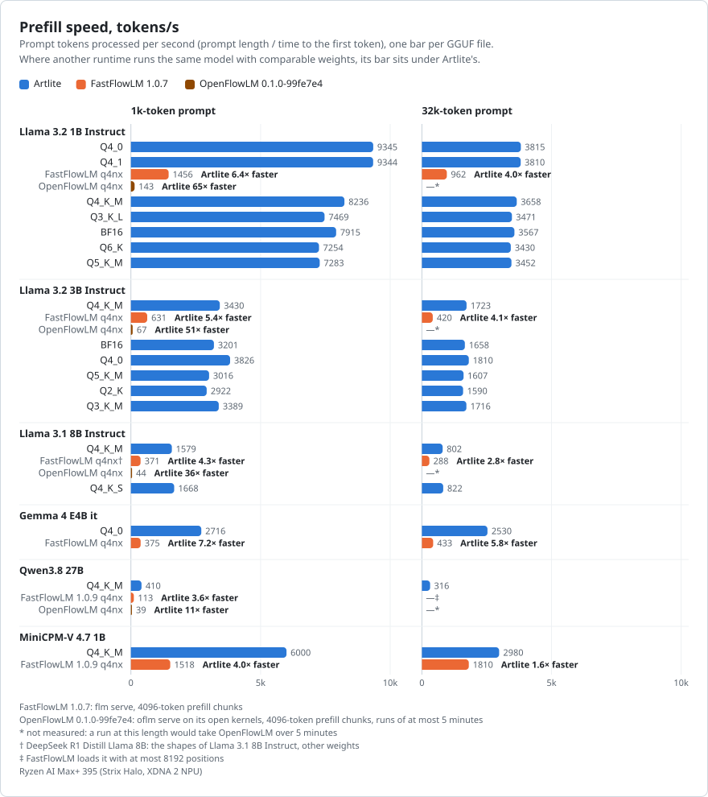
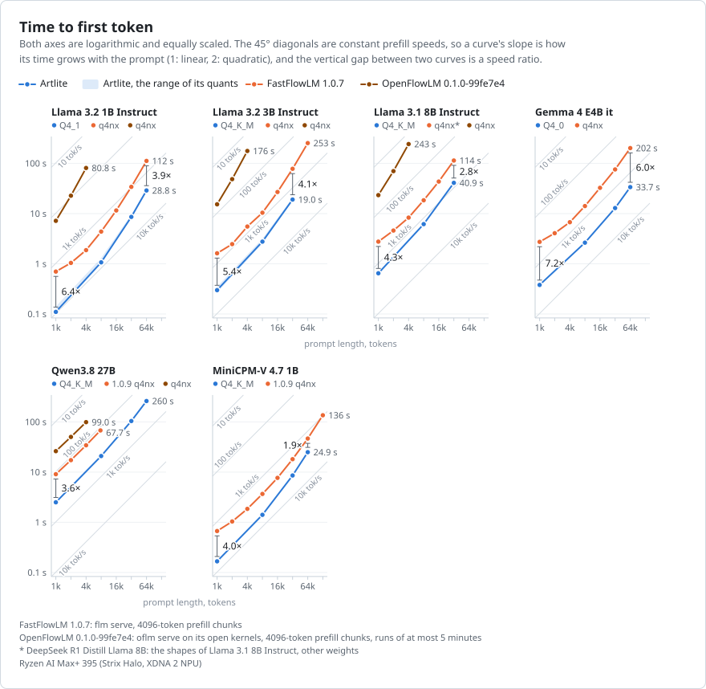
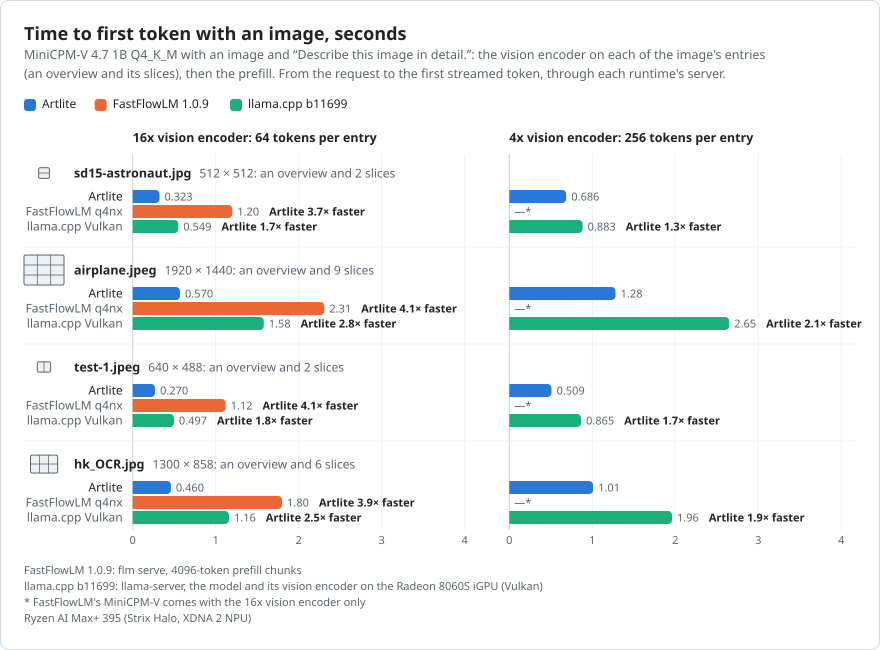
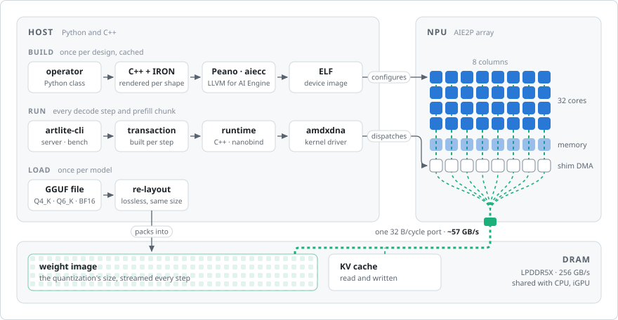

<p align="center">
  <picture>
    <source media="(prefers-color-scheme: dark)" srcset="docs/images/logo-dark.svg">
    
  </picture>
</p>

<p align="center">
  <b>AI Engine RunTime, lite</b>: language models and image generation on the NPU of AMD Ryzen AI processors
</p>

<p align="center">
  <a href="LICENSE"></a>
  
  
  
</p>

Artlite runs LLMs and Stable Diffusion on the XDNA 2 NPU (an AIE2P AI Engine array) of AMD's Strix Point, Krackan
Point and Strix Halo processors. Its runtime is a small C++ library that talks to the `amdxdna` driver directly, in
place of XRT; on Windows 11 the same library runs through XRT.

Its kernels are compiled at run time, as with NVRTC and HIPRTC, from sources generated for the task: each operator
renders C++ specialized for its shapes, data formats and place on the array, plus an IRON design of the array's data
movement. oneDNN generates such kernels (brgemm, fused graph partitions) as machine code with xbyak; Artlite generates
C++ and lets Peano, LLVM for AI Engine, optimize it, steered by hints chosen per loop. Everything is tuned for this one
device rather than for portability.

- **GGUF files as they are.** No conversion step, no extra copy of the weights.
- **Prompt and generation on the NPU.**
- **Tools in llama.cpp's style.** `artlite-cli`, `artlite-server` (an OpenAI-compatible API and llama.cpp's web chat)
  and `artlite-bench`, with llama.cpp's option names where they apply.

> [!NOTE]
> Artlite is mostly research into how far this hardware can be pushed, and where the NPU is the right device for the
> work. The CPU, the iGPU and the NPU share one power budget and one LPDDR5X bus. The iGPU reads that bus at its full
> width, but it throttles under a power cap and on battery; the NPU computes at about 8 W.
>
> The NPU's limit is memory bandwidth. All its DRAM traffic goes through one 32-byte-per-cycle port clocked by the AI
> Engine array: ~57 GB/s on Strix Halo, where the iGPU reads ~244 GB/s of the 256 GB/s bus. Decode, which reads every
> weight once per token, is therefore ~3.6x faster on the iGPU, with Artlite's decode already close to the NPU's limit.
> Compute-bound work such as prefill runs on par with the iGPU, at a fraction of its power, and leaves the iGPU free.
> Which workloads belong on the NPU is not fully explored yet: [Where the NPU fits](docs/npu-vs-igpu.md) has the
> measurements and the candidates.
>
> Planned: more vision models, model formats besides GGUF (Stable Diffusion already loads diffusers safetensors), and the
> iGPU of the same processors for memory-bound work.

## Quick start

Requirements: a Ryzen AI processor with an XDNA 2 NPU, Linux with the `amdxdna` driver, libdrm, CMake, a C++23
compiler and [uv](https://docs.astral.sh/uv/). Details: [Installation](docs/install.md) (Windows 11: [through
XRT](docs/install.md#windows)).

```bash
git clone https://github.com/artlite-project/artlite && cd artlite
uv venv && source .venv/bin/activate
uv sync --extra examples
uv pip install --no-build-isolation -ve .
```

Models are found by path, or relative to `ARTLITE_MODELS_DIR` (default `~/.artlite/models`) as
`<account>/<repository>/<file>`, the way Hugging Face names them:

```bash
uvx --from huggingface_hub hf download ggml-org/gemma-4-E4B-it-GGUF \
    gemma-4-E4B-it-Q4_0.gguf mtp-gemma-4-E4B-it-Q4_0.gguf --local-dir ~/.artlite/models/ggml-org/gemma-4-E4B-it-GGUF

M=ggml-org/gemma-4-E4B-it-GGUF/gemma-4-E4B-it-Q4_0.gguf
artlite-cli -m $M -p "Factorize x^2 + x - 6"     # the answer streams to stdout
artlite-server -m $M -rea on                     # an OpenAI-compatible API and a web chat on http://127.0.0.1:8080
artlite-bench -m $M -p 1024,8192 -n 128          # prompt and generation speeds, as llama-bench
```

<picture>
  <source media="(prefers-color-scheme: dark)" srcset="docs/images/server-dark.png">
  
</picture>

Every option: [artlite-cli](docs/cli.md) (text and images), [artlite-server](docs/server.md),
[artlite-bench](docs/bench.md).

## Models

| model | weights | on the NPU |
|---|---|---|
| [Llama 3.2 1B, 3B, Llama 3.1 8B Instruct](docs/models/llama3.md) | GGUF Q2_K to Q6_K, Q4_0, Q4_1, BF16 | prefill, decode |
| [Gemma 4 E4B it](docs/models/gemma4.md) | GGUF Q4_0 | prefill, decode with its MTP drafter |
| [Qwen3.5 9B, Qwen3.6 27B, Qwen3.8 27B, MiniCPM-V 4.7 1B](docs/models/qwen35.md) | GGUF Q4_K_M | prefill, decode; MiniCPM-V's vision encoder |
| [Stable Diffusion 1.5](docs/models/sd15.md) | diffusers safetensors | the UNet and the VAE decoder |

Each model's tested files and the planned models: [Models](docs/models/README.md).

## Performance

How these are measured: [Benchmark methodology](docs/methodology.md).

<picture>
  <source media="(prefers-color-scheme: dark)" srcset="docs/images/decode-dark.svg">
  
</picture>

<picture>
  <source media="(prefers-color-scheme: dark)" srcset="docs/images/prefill-dark.svg">
  
</picture>

<picture>
  <source media="(prefers-color-scheme: dark)" srcset="docs/images/ttft-dark.svg">
  
</picture>

<picture>
  <source media="(prefers-color-scheme: dark)" srcset="docs/images/image-ttft-dark.svg">
  
</picture>

## How it works

<picture>
  <source media="(prefers-color-scheme: dark)" srcset="docs/images/how-it-works-dark.svg">
  
</picture>

Each operator is a Python class that renders a C++ kernel and an IRON design for its shapes; Peano and aiecc compile
them once into the ELF that configures the array, cached by content hash. A GGUF file's weights are re-laid-out at
load into one buffer in DRAM, at their quantization's size. Every step the host builds a transaction (a decode step
on an overlay design, whose cores read what to do from it, or a prefill chunk program assembled from a library ELF)
and dispatches it; the array's columns then stream the weights and the KV cache from DRAM through the NPU's one port.
Details: [Design](docs/design.md).

## Documentation

| | |
|---|---|
| [Installation](docs/install.md) | hardware, driver, build, models directory, troubleshooting |
| [artlite-cli](docs/cli.md), [artlite-server](docs/server.md), [artlite-bench](docs/bench.md) | the tools and every option |
| [Models](docs/models/README.md) | tested files, plans, how each model runs on the NPU |
| [Benchmark methodology](docs/methodology.md) | how the charts are measured: test system, files, other runtimes |
| [Where the NPU fits](docs/npu-vs-igpu.md) | bandwidth and power against the iGPU, workloads to explore |
| [Design](docs/design.md) | runtime layers, C++ and Python API, kernel compilation, driver behaviour |
| [Development](docs/development.md) | tests, environment variables, kernel tools |

## License

Copyright (C) 2025-2026 Artlite contributors

Artlite is free software: you can redistribute it and/or modify it under the terms of the GNU General Public License
as published by the Free Software Foundation, either version 3 of the License, or (at your option) any later version.
It is distributed in the hope that it will be useful, but WITHOUT ANY WARRANTY; without even the implied warranty of
MERCHANTABILITY or FITNESS FOR A PARTICULAR PURPOSE. See the GNU General Public License ([LICENSE](LICENSE)) for more
details.
