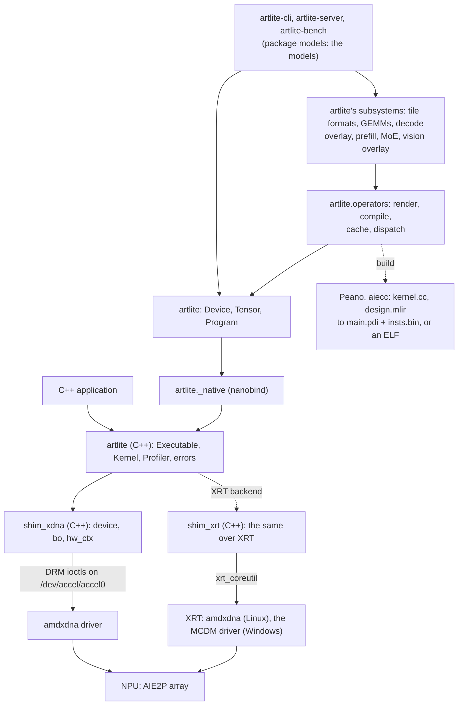

# Design

A C++ / Python runtime for AMD Ryzen AI NPUs that talks to the `amdxdna` kernel driver directly, without XRT; on
Windows (and on Linux where XRT is installed) the same runtime runs over XRT's API ([Backends](#backends)).

Components:
- **artlite** - C++ library (Device, Buffer, HwContext, Executable, Kernel)
- **artlite._native** - Python bindings via nanobind (C++ extension)
- **artlite.operators** - Python AIE runtime compiler (JIT compilation, HIP RTC style)
- **artlite**'s subsystems - what the models share: tile formats, GEMMs, the decode overlay, the prefill, MoE layers,
  the vision overlay
- **models** - the models on the NPU (Llama 3.x, Gemma 4, Qwen3.5 / 3.6 / 3.8, MiniCPM-V 4.7, Stable Diffusion 1.5)
  and the tools `artlite-cli`, `artlite-server`, `artlite-bench`

Building: [Installation](install.md); tests and kernel tools: [Development](development.md).

---

## Architecture



**Layer separation:**
- **artlite namespace**: High-level wrappers for kernel dispatch and executable loading
- **shim_xdna namespace**: Low-level DRM shim for device management, buffer allocation, and hardware contexts

**Supported hardware**: AIE2P (NPU2) only - AMD Strix Point, Strix Halo, Krackan (4 rows x 8 cols).

### Backends

`artlite._native` is one of two builds of the bindings and the C++ library, on one of two shims with the same
`shim_xdna` interface: Artlite's own on the `amdxdna` ioctls (Linux) and `csrc/shim_xrt` on XRT's API (Windows' only
one; on Linux a second module, `artlite._native_xrt`, where XRT is installed). `ARTLITE_BACKEND` picks one per
process (`artlite.backend`, which also lists what the Python side does differently on XRT); `artlite.portable` holds
the operating system's part of the Python side (file locks, process groups). On XRT a context opens from an xclbin
that `shim_xrt/xclbin.cpp` builds around the PDI, a command lists at most 5 buffers (data buffers lie in shared
regions), buffers take their device address per context, and a fused ELF's control program runs as a transaction
(`txn.without_ddr_patches`). On Linux the two are level but for that last point: the firmware runs a control program
slower as a transaction than as an ELF (a small fused ELF ~30 us more per dispatch, prefill 2-6% slower).

---

## C++ API

```cpp
#include "shim_xdna/device.h"
#include "shim_xdna/bo.h"
#include "shim_xdna/hwctx.h"
#include "artlite/executable.h"
#include "artlite/kernel.h"

// 1. Open device (shim_xdna namespace)
shim_xdna::device dev(/*device_index=*/0);
// n_rows and n_cols are auto-detected from hardware

// 2. Load PDI and NPU instructions
auto exe = artlite::Executable::from_files("main.pdi", "insts.bin");
const artlite::KernelEntry& entry = exe.entry("MLIR_AIE");

// 3. Create hardware context
std::unique_ptr<shim_xdna::hw_ctx> ctx = dev.create_hw_context(entry.pdi, "MLIR_AIE");

// 4. Allocate buffers (alloc_bo returns std::unique_ptr<shim_xdna::bo>)
auto buf_in  = dev.alloc_bo(size, static_cast<uint32_t>(XCL_BO_FLAGS_HOST_ONLY));
auto buf_out = dev.alloc_bo(size, static_cast<uint32_t>(XCL_BO_FLAGS_HOST_ONLY));
const auto& insts = entry.asm_instr_runlist.at(0);
auto ctrl = dev.alloc_bo(insts.size() * sizeof(uint32_t),
                         static_cast<uint32_t>(XRT_BO_FLAGS_CACHEABLE));

// 5. Fill buffers
auto* in_span = static_cast<int32_t*>(buf_in->map());
for (int i = 0; i < N; ++i) in_span[i] = i;
buf_in->sync(shim_xdna::direction::host2device);

// Write NPU instructions into ctrl buffer
std::memcpy(ctrl->map(), insts.data(), insts.size() * sizeof(uint32_t));
ctrl->sync(shim_xdna::direction::host2device);

// 6. Dispatch (waits for completion)
artlite::Kernel kern(dev, *ctx);
kern.dispatch(*ctrl, {std::ref(*buf_in), std::ref(*buf_out)});

// 7. Read results
buf_out->sync(shim_xdna::direction::device2host);
auto* out_span = static_cast<int32_t*>(buf_out->map());
```

### Key classes

**shim_xdna namespace (low-level DRM shim):**

- **`device`** - Opens `/dev/accel/accel0`, allocates buffers, creates contexts.
  Auto-detects `n_rows` and `n_cols` from hardware metadata.
- **`bo` (buffer object)** - DRM buffer object with `map()`, `sync()`, and `get_properties()`.
  Two allocation modes: `alloc_bo(size, XCL_BO_FLAGS_HOST_ONLY)` (uncached) and
  `alloc_bo(size, XRT_BO_FLAGS_CACHEABLE)` (cacheable). `alloc_user_bo(size)` (Python
  `Device.alloc_user_buffer`) is a host-only BO in the process's own memory: 2 MB pages faulted in and
  flushed by several threads, then pinned by the driver (a userptr BO); 16 GB in ~0.3 s, where the driver
  allocates a SHMEM BO's pages in one thread (1.7 s). `OverlayDevice.alloc` uses it from 64 MB on. `artlite::read_file` (Python
  `Buffer.read_file`) loads a file range into a BO: parallel preads through cache-resident
  bounce buffers and non-temporal AVX-512 stores (a page-cached 2 GB weight image: ~34 ms,
  `read()` 124 ms).
- **`hw_ctx` (hardware context)** - Bound to one PDI configuration.
  Created via `device::create_hw_context()`.

**artlite namespace (high-level wrappers):**

- **`Executable`** - Loads a PDI and an instruction file as one entry (`MLIR_AIE`): the PDI
  binary and the NPU instruction stream.
- **`Kernel`** - Dispatches commands: writes the ERT command packet into a pooled
  exec buffer, submits it (one EXEC_CMD ioctl) and waits for completion.
  Takes `shim_xdna::device&` and `shim_xdna::hw_ctx&` in constructor.
  `dispatch_elf` runs a patched ELF instruction buffer (`FusedOperator`); `dispatch_elf_async`
  returns at once (several may be pending), then `dispatch_poll` (no syscall) /
  `dispatch_wait`. The caller keeps a pending dispatch's buffers alive (the driver does not;
  the Python binding holds references until the wait).

---

## Python API

### Low-level bindings (`artlite._native`)

Direct nanobind bindings to the C++ API:

```python
from artlite import _native as al
import numpy as np

dev = al.Device()
exe = al.Executable.from_files("main.pdi", "insts.bin")
ctx = dev.create_context(exe)

# Instructions buffer
insts = exe.entry().asm_instr_runlist[0]
ctrl = dev.alloc_insts_buffer(insts.nbytes)
ctrl.map()[:] = insts.view(np.uint8)
ctrl.sync_to_device()

# Data buffers (zero-copy: .map() returns a numpy view)
buf_in = dev.alloc_host_buffer(N * 4)
buf_out = dev.alloc_host_buffer(N * 4)
buf_in.map().view(np.int32)[:] = np.arange(N, dtype=np.int32)
buf_in.sync_to_device()

kern = al.Kernel(dev, ctx)
kern.dispatch(ctrl, [buf_in, buf_out])
buf_out.sync_from_device()

result = buf_out.map().view(np.int32)
```

### High-level API (`artlite`)

Python AIE runtime compiler for just-in-time kernel compilation (HIP RTC style):

```python
import artlite

# Simple usage (auto-sync)
prog = SomeOperator(...).compile()
output = prog.run(input_tensor)

# Pipeline usage (explicit sync, tensor reuse)
dev = artlite.Device()
op_a = OpA(...).compile(device=dev)
op_b = OpB(...).compile(device=dev)

x = artlite.from_torch(x_torch, dev)
tmp = artlite.empty(x.shape, dtype=x.dtype, device=dev)
y = artlite.empty(x.shape, dtype=x.dtype, device=dev)

op_a.dispatch(x, tmp)  # no host sync
op_b.dispatch(tmp, y)  # tmp stays on device
result = y.to_torch()  # one sync at the end
```

**Key classes**:
- **`Device`** - Shared NPU device context for tensor allocation and program dispatch
- **`Tensor`** - Device-resident tensor with explicit sync control
- **`Program`** - Compiled AIE program ready for dispatch

**Operators**, in layers (`src/artlite/`, then `src/models/`): the framework (``operators/``: ``base``, ``design``,
``checks``, ``render_cache``, ``l1_layout``, `FusedOperator` in ``fused``, which links several operators into one
program and checks that the host initializes every buffer the program reads; ``kmath``, ``bfp16``; the kernels'
headers in ``include/``), and the runtime of the designs run by host-built transactions (``overlay.py``); the
subsystems the models share: the GGUF tile formats (``formats/``, one slot per format: Q4_0, Q4_1, Q8_0, Q4_K, Q5_K,
Q6_K, Q2_K, Q3_K, IQ3_XXS, BFP16 for BF16 / F16 tensors), the GEMMs on the decode tiles (``gemm/``: GemmQ, GemmQd,
their MAC loop), the decode overlay (``decode/``: GEMV cores, the weight image, the KV record format, the attention
core of Gemma and Llama, the models' shared host side), the prefill's chunk programs, GEMM planner, norms and
attention (``prefill/``), MoE layers (``moe/``), the vision overlay (``vision/``: an image network per dispatch); then
each model's own (``models/llama/``: weight image, decode design, prefill; ``models/qwen35/``; ``models/gemma4/``;
``models/minicpmv/``; ``models/sd15/``).

Build-time checks (``operators/checks.py``, every compile): kernel stack depth vs
each core's ``stack_size``, kernel signatures vs the design's declarations, and a
warning for rounding kernels that do not set the rounding mode. Data layouts can be
tested without an NPU with the host DMA model ``tests/dma_model.py`` (``tests/gemm/test_dma.py``).

---

## Kernel compilation pipeline

`ArtcOperator.compile()` (`src/artlite/operators/base.py`) builds two
artifacts that Artlite loads directly, cached per content hash in
`~/.cache/artlite/rtc_<hash>/`:

- **PDI binary** (`main.pdi`) - the device image (CDOs wrapped by bootgen)
- **NPU instructions** (`insts.bin`) - shim DMA programming (uint32 arrays)

```
get_kernel_src()  ->  kernel.cc   (Jinja2-rendered C++, each name resolved to
    |                             <stem>_<name>_<hash of its code>; "operators.h"
    |                             as a precompiled header)
    |  Peano clang++ -O2 -std=c++20 --target=aie2p-none-unknown-elf
    v
kernel.o
get_mlir_artifact()  ->  design.mlir   (aie.iron design linking kernel.o)
    |  aiecc --get-pdi --get-npu-insts --peano=<llvm-aie> \
    |        --pdi-name=main.pdi --npu-insts-name=insts.bin
    v
main.pdi + insts.bin  (loaded by artlite.Program)
```

A fused program (`FusedOperator`, `Library`) builds its designs into one ELF the same way, its operators' kernels as
one `kernel.cc`: a section per operator, each definition once (a name is a hash of its code, so the same helper of two
operators, or of two configurations of one, is one function; a section lists what it shares with earlier ones). The C++ test build
(`tests/csrc/CMakeLists.txt`) runs the same `aiecc` step through its `add_aie_target()` function.

The first run of a model compiles its designs, from seconds to a few minutes per model (Stable Diffusion's UNet
program: about 2 minutes); later runs load them from the cache (`ARTLITE_CACHE_DIR` moves it). Uncached designs
build in parallel, `ARTLITE_COMPILE_JOBS` at a time (default: the CPU count).

The map of the code: [AGENTS.md](../AGENTS.md#map).

---

## Error handling

All errors are C++ exceptions inheriting from `artlite::Error` (`std::runtime_error`):

- `artlite::ExecutableError` - PDI/insts file load failures
- `artlite::DispatchError` - command failures and wait timeouts: `state` (the ert command
  state: ERROR 5, ABORT 6 = cancelled by a stall recovery, TIMEOUT 8 = stopped by the driver's
  hang detection, or the pending state when a wait timed out) and on TIMEOUT `health`, the
  firmware's report (`txn_op_idx`: the last control-code operation it ran, `ctx_pc`, fatal
  error fields)

Low-level DRM errors from the `shim_xdna` layer are thrown as `std::system_error` (with the
errno) with descriptive messages.

In Python, these map to `artlite.Error`, `artlite.ExecutableError`, and `artlite.DispatchError`
(attributes `state`, `state_name`, `health`: a dict or None). The overlays' runtime adds the
transaction operations at `txn_op_idx` to the message. `HwContext.status()` and
`Device.last_async_error()` query the firmware through the management mailbox: use them after
a clean failure, never while a job may be hung (a mailbox timeout destroys the channel).

---

## Driver behaviour (amdxdna, AIE2P)

- A context runs at most 4 commands at a time; a 5th submit blocks until one completes. The
  driver writes a command's state before it signals its timeline point, so polling the state
  word is safe; it resets the state to NEW only when the job starts, so the runtime writes NEW
  before each submit. After any failure the driver overwrites the packet with 0xff (the health
  record on TIMEOUT): the runtime rewrites every packet word per dispatch.
- EXEC_CMD's argument BOs: xdna-driver's module ignores them (it neither pins them nor keeps them
  alive for the job); Linux's own driver looks up, pins and locks each one in the DRM file the
  command is submitted to. So the runtime lists each BO once, and a process opens one DRM file
  per device: every `Device` of an index shares it (`pdev::open`), as does XRT.
- DEV BOs (control code, PDIs) are ranges of the DRM file's device heap: heap BOs of 64 MB,
  contiguous in the NPU's and the CPU's addresses, added while a DEV BO does not fit, up to
  512 MB. The driver places each DEV BO at 32 KB and takes 128 KB per hardware context from the
  heap (`Device.heap_free` counts both). Linux's driver before 7.2 allows one heap BO: 64 MB per
  process (`Device.heap_fixed` once it refused one; a full heap raises `HeapFullError`). There a
  prefill's instruction pieces (`fused.library.Pieces`: two per process) take what the heap has
  left but 8 MB instead of 24 MB each: only more dispatches.
- Reading AIE tiles (`HwContext.read_aie_reg`: counter profiling, the paging probes) and a
  context's status are xdna-driver requests; Linux's driver serves neither (NotImplementedError).
- In PASID mode the NPU addresses BOs by user VA through MMU notifiers: a `munmap`,
  `mprotect` or `fork` of a BO range while a job runs blocks until the client is idle. Allocate
  BOs before dispatching, and don't free buffers or spawn processes during an async dispatch.
- The device runtime-suspends 5 s after the last job or ioctl, open contexts or not; a resume
  re-creates every context in the firmware. `FusedOperator` and `Program` create their context
  at the first dispatch.
- Hang detection is device-wide (a hang aborts every context's work: ABORT) and nothing can
  cancel a submitted command.

Measured and rejected:

- Weights in a userptr BO over 2 MB pages: decode 0.8% slower (3B Q4_K_M 37.6 vs 37.3 ms);
  over the weight file's page cache (no copy, loads 2 GB in 70 ms instead of 430 ms) 0.6%
  slower. The DMA ceiling is not translation-bound.
- One hardware context for the prefill and decode ELFs: no gain. The ~1.8 ms of the first
  decode step after a prefill is the decode design's reconfiguration, not the context switch.
- Command chains, queues, fences: every dispatch depends on host results of the previous one;
  the driver rejects fences.
- CLFLUSHOPT instead of CLFLUSH: same speed on Zen 5 (~92 GB/s dirty, ~120 GB/s clean).
- Configuration as control packets (`aiecc --load-pdi-to-ctrl-pkt`, the ELF's `.ctrldata`
  patched like a data buffer): runs correctly on a small design, but its overlay takes shim
  MM2S channels the prefill operators use ("requires at least 3 MM2S channels"), and it streams
  the configuration on every dispatch where an unchanged PDI load is skipped. What works
  instead: a route of our own only while a library configuration loads
  (`fused.ctrlpkt`), the design's own ports written after it.
- The decode overlay's transactions as ELF commands on the prefill library's context:
  no PDI reload before them (the 2.2 ms after a prefill: the firmware reloads a context's PDI before a
  transaction command that follows another PDI load), the overlay set up by its expanded configuration
  instead. Rejected: a fresh context's first ELF command finds no configuration, and with another
  process's context in between the overlay's steps hung (nothing restores an ELF context's array).
