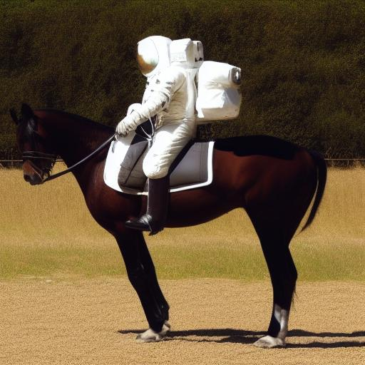

# Stable Diffusion 1.5 on the NPU

Text to image, 512x512, from a diffusers directory (`model_index.json` naming `StableDiffusionPipeline`), its
networks' safetensors read directly. Running it: [artlite-cli](../cli.md#images).

```bash
artlite-cli -m stable-diffusion-v1-5/stable-diffusion-v1-5 -p "a photograph of an astronaut riding a horse" \
    -o astronaut.png
```



```
stable-diffusion-v1-5 (Stable Diffusion 1.5): loaded in 0.6 s
text encoder: 0.10 s; 20 steps (euler_a, cfg scale 7): 2.17 s (0.11 s per step); VAE decoder: 0.29 s
astronaut.png: 512x512, seed 1608560892
```

## Model files

```
$ARTLITE_MODELS_DIR/stable-diffusion-v1-5/stable-diffusion-v1-5/      stable-diffusion-v1-5/stable-diffusion-v1-5
    model_index.json, scheduler/scheduler_config.json
    unet/        config.json, diffusion_pytorch_model.safetensors     (3.4 GB, F32)
    text_encoder/ config.json, model.safetensors                      (CLIP ViT-L/14)
    vae/         config.json, diffusion_pytorch_model.safetensors
    tokenizer/   vocab.json, merges.txt
```

```bash
uvx --from huggingface_hub hf download stable-diffusion-v1-5/stable-diffusion-v1-5 \
    model_index.json scheduler/scheduler_config.json \
    unet/config.json unet/diffusion_pytorch_model.safetensors \
    text_encoder/config.json text_encoder/model.safetensors \
    vae/config.json vae/diffusion_pytorch_model.safetensors \
    tokenizer/vocab.json tokenizer/merges.txt \
    --local-dir ~/.artlite/models/stable-diffusion-v1-5/stable-diffusion-v1-5
```

## How it runs

- The UNet and the VAE decoder run on the NPU: each step, for the prompt and the negative prompt, is one dispatch of a
  static design run by a host-built transaction, every level of the UNet in it; the decoder is one dispatch on the
  same design. The text encoder runs on the CPU (fp32, one thread; the last prompts' encodings kept, so an unchanged
  negative prompt costs nothing). Every load converts the weights from the safetensors files into bfp16 images (on
  all cores: ~0.13 s for the UNet's 3.4 GB in the page cache); the first also builds the dispatches (~8 s) and caches
  them (~60 MB in the cache directory, `ARTLITE_CACHE_DIR`, keyed by the model's files and the code; no weights), so
  later loads take ~0.6 s.
- A seed's noise is numpy's PCG64 generator's: images do not match other implementations' (diffusers', torch's) for
  the same seed.

Samplers: `euler_a` (default), `euler`, `ddim`; classifier-free guidance with `--cfg-scale`.

Design: the module docstrings of `src/models/sd15/` (`npu.py`, `model.py`, `unet.py`, `vae.py`) and of the vision
overlay it runs on, `src/artlite/vision/`; how its cores load their roles' code: [Universal programs](../paging.md).
