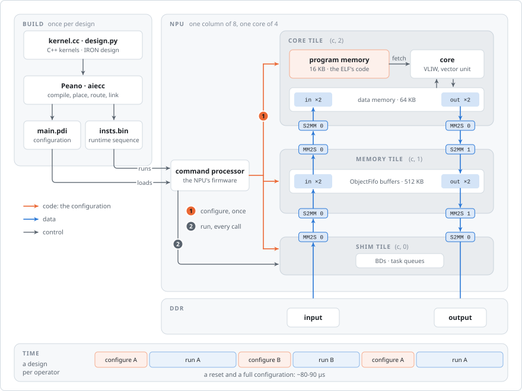
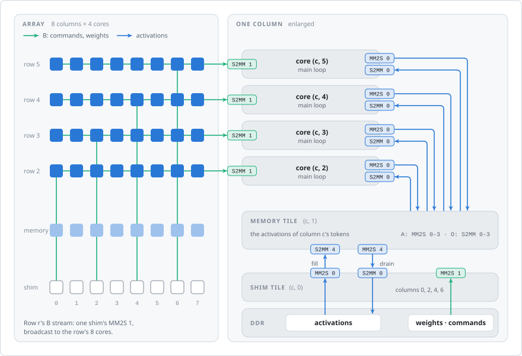
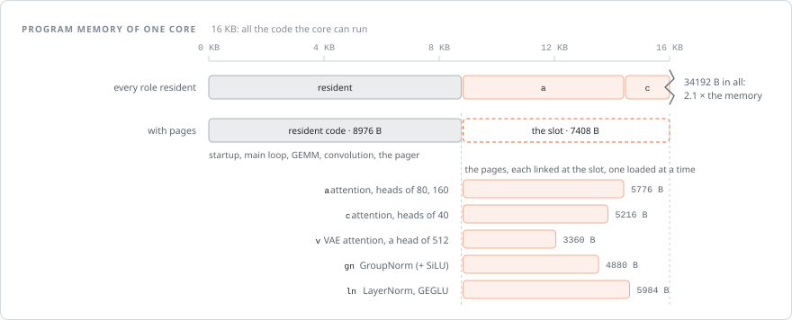
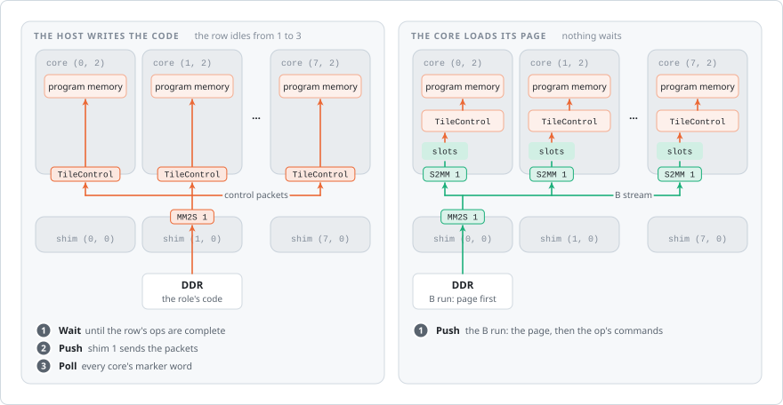
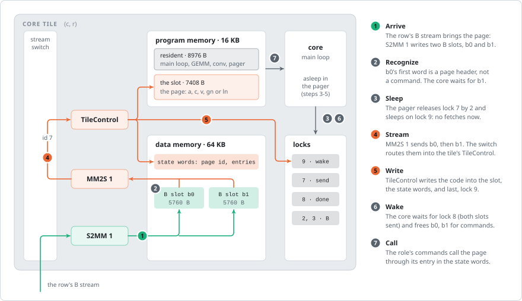
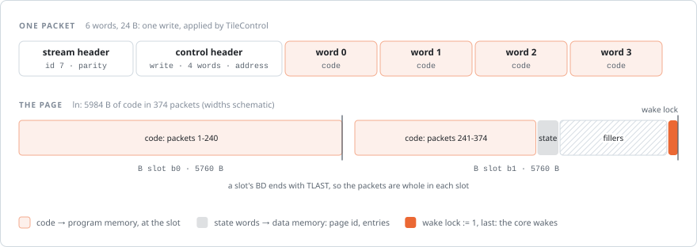
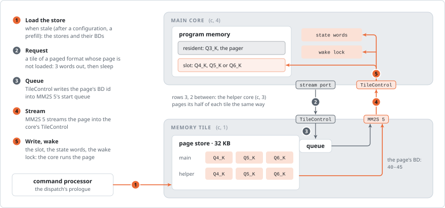
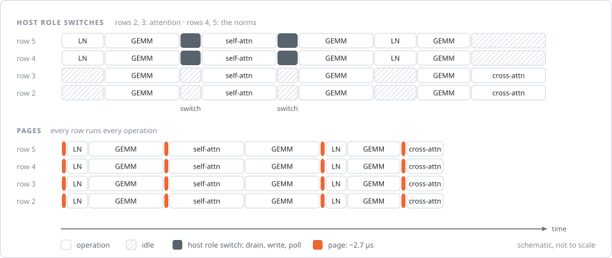

# Universal programs: cores that load their own code

An AIE2P core runs only the code in its own program memory: 16 KB. In a classic design that code is part of the
configuration, so a core's program is fixed until the next configuration. Artlite instead runs a whole network on
one static design whose cores execute commands (an overlay). When the code of every command no longer fits in
16 KB, the cores load the part they need next themselves, as **code pages**. A design is then a universal program:
one configuration for every operation, whatever the size of its code. This page explains the mechanism with Stable
Diffusion 1.5's UNet as the example, and the decode overlays' variant after it.

## A classic design

<picture>
  <source media="(prefers-color-scheme: dark)" srcset="images/paging-classic-dark.svg">
  
</picture>

An mlir-aie (IRON) design describes one operator. Peano compiles its C++ kernels, and aiecc places the design's
workers on cores, routes its ObjectFifos through the stream switches and links one ELF per core. Two artifacts come
out:

- **the PDI**, the configuration of every tile it uses: each core's program memory (its ELF's code), its data memory,
  locks, DMA buffer descriptors (BDs), and the stream switches' routes;
- **insts.bin**, the runtime sequence: what the NPU's command processor does per call, which is to program the shim
  tiles' BDs, start them and wait for them.

Every arrow in the figure is fixed by the configuration. At run time only data moves: from DDR through the shim
tile's MM2S channel (memory to stream) into the memory tile's S2MM channel (stream to memory), on to the core's data
memory, and back the same way. A DMA channel walks a chain of BDs, and locks hand each buffer between the DMA and the
core.

A different operator is a different design, and loading one costs a reset and a full configuration of the array.
Artlite's prefill library measures about 80-90 µs per change of design. A model that runs dozens of operators per
step cannot afford that between each pair.

## An overlay: one design, the program in commands

<picture>
  <source media="(prefers-color-scheme: dark)" srcset="images/paging-overlay-dark.svg">
  
</picture>

Artlite's sd15 design is configured once, and every operation of the UNet and the VAE decoder runs on it. Every stream
runs on every call:

- **B** (green): each core row has one broadcast stream from a shim tile (columns 0, 2, 4, 6 for rows 2-5) to the
  row's 8 cores. It carries the commands, and the weights of the row's channel slice. One read of a weight feeds 8
  cores.
- **A** (blue): each column's memory tile holds the activations of that column's tokens and sends each of its 4 cores
  the objects it needs.
- **O**: the cores' outputs go back to their memory tile.
- **Fills and drains**: the shim tile moves activations between DDR and the memory tile.

Each core runs one main loop. It takes a command from its B stream and calls the code for it: a GEMM, a convolution,
an attention, a normalization. The host builds each dispatch's transaction: the memory tiles' tasks, the B runs and
the locks that hand one operation to the next. Changing what the cores do costs nothing, as long as the main loop
holds the code for every command.

## When the code does not fit

<picture>
  <source media="(prefers-color-scheme: dark)" srcset="images/paging-budget-dark.svg">
  
</picture>

sd15's cores need 34 KB of code: the main loop, GEMM and convolution, plus five roles' code. The roles are attention
of heads of 80 and 160 (`a`), attention of heads of 40 (`c`), the VAE's attention (`v`), GroupNorm (`gn`) and
LayerNorm with GEGLU (`ln`). Only one role is needed at a time. Each role becomes a **page**: code linked at the
**slot**, the program memory after the resident code, and loaded into it when an operation needs it.

## Two ways to change the code at run time

<picture>
  <source media="(prefers-color-scheme: dark)" srcset="images/paging-paths-dark.svg">
  
</picture>

Every tile has a **TileControl** port: a stream port that accepts control packets, each a write of 1 to 4 words to
any address of the tile, program memory included. Program memory can therefore be rewritten while the design runs.
Who sends the packets matters.

- **The host writes the code.** The packets come from a shim tile on a route of their own. A program-memory write
  fails while the core fetches from it, so the host must first wait until the row has finished its queued
  operations. It then sends the packets and polls each core until they arrived. The array drains, and the command
  processor waits at every switch.
- **The core loads its page.** The page travels in the row's B stream like any command, ahead of the operation that
  needs it. The host only decides where the page goes in the stream; it never waits for it. Each core receives it in
  its B slots and forwards it into its own TileControl.

## A page load, step by step

<picture>
  <source media="(prefers-color-scheme: dark)" srcset="images/paging-steps-dark.svg">
  
</picture>

The design gives each core a route inside its own stream switch, from its MM2S 1 channel to its TileControl (packet id
7 on every core), and a fixed BD chain on MM2S 1 over the two B slots. The core never copies the page itself: its DMA
streams the slots, and TileControl applies them as writes.

The locks order every step:

- **Lock 7** lets MM2S 1 send. The core releases it by 2, once per slot.
- **Lock 8** counts the slots sent. The core waits for both before it frees the slots for the next commands.
- **Lock 9** wakes the core. The page's last packet sets it. The core sleeps on it in a small resident function, the
  pager, so it fetches nothing from program memory while its slot is being written.

The core never calls page code by name. The page's packets also write the pager's **state words** in data memory:
the page's id and the addresses of its entry functions. The main loop calls the role's code through those
addresses. The entries are ordinary C++ functions that only these addresses reach.

<picture>
  <source media="(prefers-color-scheme: dark)" srcset="images/paging-packets-dark.svg">
  
</picture>

The page in the stream is control packets of at most 6 words: a stream header (packet id 7), a control header (a
write, 1-4 words, an address) and the words. A B slot's BD ends the stream's packet at the slot's end (TLAST), so
the packets are packed whole into each slot. Filler packets pad the last slot by rewriting the state words with
their own values, and the packet that sets the wake lock comes last. Whatever the page's size, the core streams two
slots: 11.5 KB in about 4800 cycles (~2.7 µs).

## How a page is built

Pages come from the same C++ source and object file as the rest of the core's program:

1. aiecc links the core's ELF as usual. Its code up to the startup function `_main_init`, which runs once and is
   linked last, is the **resident code**. The slot starts at `_main_init`.
2. `paging.link` copies `kernel.o`. In the copy, it renames the sections of the functions that only a page's entries
   reach (`.text.f` to `.ptxt.f`). It links the copy with a copy of the core's linker script that places those
   sections at the slot. Every page is a separate link.
3. It checks the result against aiecc's:
   - the resident code and data come out byte for byte the same, on every core that shares the pages;
   - every page fits between the slot and 16 KB;
   - no page needs data of its own: constant tables or jump tables are refused, or kept resident;
   - no page reaches the pager;
   - the deepest call, through the page entries, fits the stack.

The link runs once per design and is cached next to it.

## Hazards and their guards

| Hazard | What would go wrong | Guard |
|---|---|---|
| Program memory written while the core fetches | The fetch wins; the write fails (SLVERR, AM027) | The core sleeps on the wake lock from just after the trigger until the page's last packet |
| An acquire in a jump's delay slots | The core fetches the jump's target before the acquire completes, so it runs stale code | The wake lock is acquired only in the pager, which has no jumps (`check_pager`); page code is entered after the pager returns |
| Code overwritten while it runs | A page replaces a function still on the stack | Pages lie above the resident code, and no page reaches the pager (`link`'s call graph) |
| Writes past 16 KB | They land in the tile's other registers and break the core | `link` refuses a page that does not fit |
| Page data | Data memory holds only the resident ELF's data | `link` refuses a page that needs data of its own |
| A stale page after a configuration | A PDI load rewrites the slot's start but keeps the state words | The state words are cleared after one (memory tile transport), or a dispatch always sends its first page (self-DMA) |
| A packet across slots | A slot's BD ends with TLAST and cuts the packet | `Pager.slots` packs whole packets per slot |
| A dispatch ending with tasks queued | The next dispatch rewrites the BDs, and the queued task streams its data: a page twice or out of place | sd15 waits for the last push of every B stream at the end |
| A full task queue (memory tile transport) | A push to a full queue is dropped | One channel serves at most 4 cores, with one request in flight each |
| A queue shared with waiting tasks (memory tile transport) | A task that waits for the cores blocks the page the cores wait for | Pages have a channel of their own |

## The memory tile transport (decode)

<picture>
  <source media="(prefers-color-scheme: dark)" srcset="images/paging-memtile-dark.svg">
  
</picture>

sd15 carries its pages in the B streams: its memory tiles have neither a free channel nor room for a store, and the
host knows each row's role. The decode overlays are the other way round: the cores decide what they need (a weight
tile's format is in the metadata they read), and their memory tiles have free channels and room. Here, the core asks
for its page. Before a tile of a paged format whose page is not loaded, it sends three words through its stream port:
a control packet that writes the page's BD id into the start queue of its memory tile's MM2S channel 5. It then
sleeps on its wake lock. MM2S 5 streams the page, which waits in the memory tile's page store, into the core's
TileControl.

A request costs 86 cycles plus about 0.39 µs per KB of code. The store and its BDs are not part of the design's
configuration. The host writes them (0.32 ms) before a dispatch when they are stale: after the configuration and
after a prefill dispatch, which configures the array for its own designs.

Llama 3.2 3B Q3_K_M uses this: its weights come in four tile formats, and the GEMV kernels of all four do not fit a
core together. Q3_K, the format with the most bytes, stays resident; Q4_K, Q5_K and Q6_K are pages. Without pages,
one format's tiles would run on the helper core alone.

## What it buys

<picture>
  <source media="(prefers-color-scheme: dark)" srcset="images/paging-timeline-dark.svg">
  
</picture>

Without pages, sd15's code must be split between rows: rows 2 and 3 hold attention and rows 4 and 5 the norms. A
norm then runs on half the array, and self-attention needs rows 4 and 5 switched by the host and switched back. With
pages, every row runs every operation, and a row loads a role's page whenever its next operation needs another role.

| | host role switches / without pages | pages |
|---|---|---|
| sd15 UNet step (512x512) | 108.3 ms | 104.4 ms: 868 page loads, 1.65 ms of it |
| Llama 3.2 3B Q3_K_M decode step | 32.4 ms | 32.15 ms; the main core's free program memory 240 B to 2.4 KB |

Pages pay only where code does not fit. Each load costs time on the critical path, about 1.9 µs per page in sd15's
UNet. The other models' decode overlays fit their cores without pages.

## Code map

| File | What |
|---|---|
| `src/artlite/operators/paging.py` | the page linker and its checks, `Pager` (page streams, slots), the pager's C++ (`pg_self`, `pg_request`), the routes (`loop_flow`, `page_flow`, `request_flow`), the memory tile's `Store` |
| `src/artlite/operators/sd15/` | `core.py` (the roles, the main loop's page branch), `design.py` (the loop routes, MM2S 1's chain, locks 7-9), `seq.py` (pages in the B runs), `runtime.py` (the roles' page images) |
| `src/artlite/operators/overlay/` | `decode.py` (`paged=`, the page store and prologue), `gemv.py` (the paged formats' entries), `runtime.py` (`OverlayDevice.set_prologue`) |
| `src/artlite/operators/llama/overlay.py` | `paged_formats`: which formats are pages |
| `tests/rtc/test_paging.py` | the linker's refusals; every core of the array paging by self-DMA and from its memory tile |

`docs/paging_diagrams.py` draws this page's figures.
