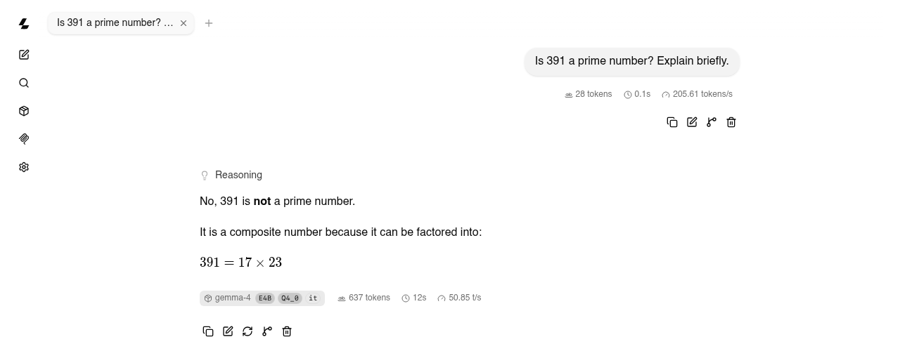
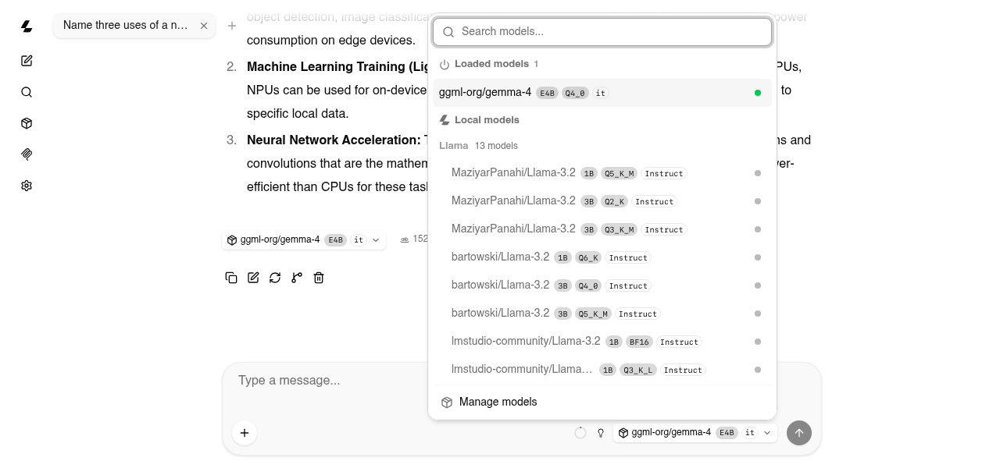

# artlite-server

Serves GGUF models as llama.cpp's `llama-server` does: an OpenAI-compatible API with llama-server's own routes and
fields, so that clients written for either work unchanged, and a web chat at `/`. With `-m` it serves that model;
without, every model of the models directory, loaded when the web chat's model picker or a request asks for it
([router mode](#several-models-router-mode)).

```bash
artlite-server -m ggml-org/gemma-4-E4B-it-GGUF/gemma-4-E4B-it-Q4_0.gguf -rea on    # then open http://127.0.0.1:8080
artlite-server                                                                      # the models directory's models
```

<picture>
  <source media="(prefers-color-scheme: dark)" srcset="images/server-dark.png">
  
</picture>

```bash
curl http://127.0.0.1:8080/v1/chat/completions -H "Content-Type: application/json" \
    -d '{"messages": [{"role": "user", "content": "Factorize x^2 + x - 6"}]}'
```

## API

| route | |
|---|---|
| `/v1/chat/completions` | chat, streamed or not, with `reasoning_content`, tool calls, `timings`, `prompt_progress`, `usage` |
| `/v1/messages`, `/v1/messages/count_tokens` | Anthropic's Messages API ([agents](#agents)) |
| `/v1/responses`, `/v1/responses/input_tokens` | OpenAI's Responses API ([agents](#agents)) |
| `/v1/completions`, `/completion` | raw prompts (OpenAI's and llama-server's shapes) |
| `/v1/models`, `/props`, `/health`, `/slots` | the model, the server's settings, its state |
| `/tokenize`, `/detokenize`, `/apply-template` | the model's tokenizer and chat template |
| `/v1/embeddings`, `/embeddings`, `/embedding` | embeddings (with `--embedding`: [below](#embeddings-and-rerank)) |
| `/v1/rerank`, `/rerank`, `/v1/reranking`, `/reranking` | a reranker's scores of documents (with `--rerank`) |
| `/classify` | a classifier's label probabilities (vLLM's shape; with `--rerank`) |
| `/v1/systemone` | a decision model's answers to questions about a state ([below](#decisions)) |
| `/v1/audio/transcriptions`, `/audio/transcriptions` | a transcription of an audio file (LFM3-Audio: [below](#speech)) |
| `/v1/realtime` | live transcription (`?intent=transcription`) and voice conversations over a websocket (OpenAI's realtime API, as llama-server: [below](#speech)) |
| `/tts`, `/v1/audio/speech`, `/audio/speech` | text to speech (llama-server's and OpenAI's; LFM3-Audio: [below](#speech)) |

Sampling has the repetition, presence and frequency penalties, the temperature, top-k, top-p and min-p. The other
sampler fields (DRY, XTC, typical-p, mirostat, ...) are accepted and ignored, and logged when not neutral: the web UI's
settings for them have no effect. Log-probabilities come as llama-server's: chat's `logprobs: true` with
`top_logprobs` (default 20) and `/v1/completions`' `logprobs: N` give each generated token's (`logprobs.content`:
`id`, `token`, `bytes`, `logprob` and the `top_logprobs`), `/completion`'s `n_probs` gives them as
`completion_probabilities`, and `post_sampling_probs` the probabilities the sampler drew from instead (`prob`,
`top_probs`). A request's `speculative.n_max` (llama-server's field) caps the draft tokens per step of its
generation, up to `--spec-draft-n-max` (0: steps of one token; a drafter still follows the tokens, so the next request
drafts as before); `/props` and `/slots` report the cap in `params`.
Images (a model with `--mmproj`: [Qwen3.5 / 3.6 / 3.8](models/qwen35.md#images-qwen35--36--38),
[MiniCPM-V 4.7](models/qwen35.md#images-minicpm-v-47), [LFM3-VL-2B](models/lfm3.md#lfm3-vl-2b-images); the decision
models d3 and d1: [below](#decisions)) come as a chat message's `image_url` parts of data URIs, as llama-server takes
them; the web UI attaches them; audio (LFM3-Audio, LFM3-Omni: [below](#speech)) as `input_audio` parts or `audio_url`
data URIs; videos (LFM3-VL-2B, LFM3-Omni-2B: [the models](models/lfm3.md#videos); FFmpeg's `ffmpeg` and `ffprobe` on
the server's PATH) as `input_video` or `video_url` parts (`{"data": ...}` or `{"url": ...}`: a data URL or base64), as
llama-server takes them (`/props`' `modalities.video`); and a chat's `modalities` with `"audio"` gets a spoken reply.
Not provided: infill, `/metrics`, LoRA, model downloads; their routes answer 501.

Tool calls (OpenAI's function calling): a request's `tools` go to the model's chat template, and the calls the model
writes come back as `message.tool_calls` (streamed: `delta.tool_calls`, a call's id and name first, then its
arguments) with `finish_reason: tool_calls`; the results go back as `role: tool` messages. Qwen3.5 / 3.6 / 3.8,
MiniCPM-V 4.7, Occamy and LFM3 (Qwen's XML calls), Gemma 4 and Llama 3.1 / 3.2 have them; a template without tools (Llama
3.2 1B Q3_K_L's file) ignores them. `tool_choice` takes `auto`, `none` (the tools stay in the prompt, nothing is
parsed), `required` and a named function (the answer begins with the call, after the model's thought; a named
function's call is the only one), and `parallel_tool_calls: false` ends the answer after its first call. A call's
name is always one of the request's functions: while the model writes it, only the tokens that spell one can come
(with `required` where no function fits, the model calls the closest one instead of inventing a name). The arguments
are not constrained by a grammar: a call the model writes malformed stays text, and a string argument whose schema
allows no string becomes the value it encodes (Llama 3.1 quotes numbers and lists).

## Chat template

A chat's messages go through the model file's chat template (`tokenizer.chat_template`), rendered as transformers and
llama.cpp render it. `--chat-template-file FILE` (or `--chat-template` with the template's text) replaces it, as
llama-server's options do: to change a tool-call syntax, a thinking switch or a broken upstream template without
rewriting the GGUF file, and, as a preset's key (`chat-template-file = ...`), to give several models one template.
It gets the variables the file's template gets (`enable_thinking`, `preserve_thinking`, `bos_token`, ...), and the
server reads from it what it reads from the file's (the tool-call syntax, whether it takes a message as text parts
and a system message after the first); `/props` and `/apply-template` show it. A template that does not render a user
message fails at load.

A request's `chat_template_kwargs` and the server's `--chat-template-kwargs` are the template's variables, as in
llama-server (the request's over the server's). A request's `reasoning_effort` (and a Responses request's
`reasoning.effort`) sets the template's `reasoning_effort` and turns the thought on, `none` off; a level that the
template refuses (Qwen3.8's takes `xhigh`, `medium` and `low`; clients send `high` or `minimal`) gives way to
`--reasoning-effort`, else the template's own default, with a log line. A level given in `chat_template_kwargs` or
by `--reasoning-effort` is the template's to take: a refused one fails the request, or the server's start.

## Agents

Coding agents and other clients that call tools use the API they speak: chat completions (opencode, Open WebUI, the
web chat), Anthropic's Messages API at `/v1/messages` (Claude Code, the Anthropic SDKs) or OpenAI's Responses API at
`/v1/responses` (Codex CLI, the OpenAI Agents SDK). All three run as the same chat request: tool calls, thoughts and
the prompt cache work alike.

```bash
artlite-server -m lmstudio-community/Qwen3.6-35B-A3B-GGUF/Qwen3.6-35B-A3B-Q4_K_M.gguf -rea on -c 131072
ANTHROPIC_BASE_URL=http://127.0.0.1:8080 ANTHROPIC_AUTH_TOKEN=none claude          # Claude Code
codex -m qwen3.6-35b-a3b -c model_provider=artlite \
    -c 'model_providers.artlite={name="artlite", base_url="http://127.0.0.1:8080/v1", wire_api="responses"}'
```

Codex needs a model name it does not know (`-m`; a server started with `-m` answers to any name): for its own models
it sends a JavaScript tool of its own instead of functions, which the server refuses. opencode takes the server as a
provider in
`~/.config/opencode/opencode.json`, without a timeout (its default ends a request after 5 minutes, and a turn that
thinks can take longer):

```json
{
  "$schema": "https://opencode.ai/config.json",
  "provider": {
    "artlite": {
      "npm": "@ai-sdk/openai-compatible",
      "name": "Artlite",
      "options": {"baseURL": "http://127.0.0.1:8080/v1", "timeout": false},
      "models": {
        "qwen3.6-35b-a3b": {"name": "Qwen3.6 35B-A3B", "tool_call": true, "reasoning": true,
                            "limit": {"context": 131072, "output": 32768}}
      }
    }
  },
  "model": "artlite/qwen3.6-35b-a3b",
  "small_model": "artlite/qwen3.6-35b-a3b"
}
```

- Messages API: `system`, the blocks `text`, `image` (base64), `thinking`, `tool_use` and `tool_result`, `tools`,
  `tool_choice`, `stop_sequences`, and Anthropic's event stream. `thinking` turns the model's thought on (`enabled`,
  `adaptive`) or off (`disabled`; without it, `-rea` decides); its budget is not enforced. A prompt longer than the
  context answers "prompt is too long: N tokens > M maximum", which Claude Code acts on.
- Responses API: `instructions`, the items `message`, `reasoning`, `function_call` and `function_call_output`,
  function tools (others, such as `web_search`, are left out), `tool_choice`, `reasoning.effort` (`none`: no
  thought; another: a thought, and the template's `reasoning_effort`: [above](#chat-template)), `max_output_tokens`,
  and OpenAI's event stream. `previous_response_id` continues one of the last 1024
  responses the server keeps (not those with `store: false`); `GET` and `DELETE /v1/responses/{id}` read and drop
  one. A prompt longer than the context fails with the code `context_length_exceeded`.
- On every route a `developer` message is a system message, and where a template takes a system message only first
  (Qwen's), the later ones become user messages: Claude Code and Codex send them during a conversation.
- Agents copy their context (an edit's old text, a file they rewrite, a command again): generation takes draft tokens
  from it ([artlite-cli](cli.md#text)), so on recorded agent sessions Qwen3.6-27B, Qwen3.5-9B and Llama 3.1 8B generate
  1.46-1.52x faster and MiniCPM-V 1.25x (Qwen3.6-35B-A3B and Gemma 4 guess with their drafters: +0-4% more).
- Models: Qwen3.6-35B-A3B is the one these three clients ran whole tasks on (each fixed a bug in a Python package, its
  tests run); with its drafter it generates ~30 tokens/s after a 1K-token prompt and ~21 after 32K. Occamy 1.0, a
  fine-tune of it for agentic tool use, takes 15.8 GB instead of 21. On 150 function-calling cases (BFCL's simple,
  multiple and parallel calls) Qwen3.6-35B-A3B, Gemma 4 E4B and Llama 3.1 8B call right in 131, 134 and 129, none
  malformed. Most of a session's time is generation, most of it the model's thoughts: a client's own thinking
  setting, or `-rea off`, turns them off.
- Context and memory: the clients' first prompts are 7-12K tokens (their instructions and tools), and a task's
  conversation often grows past the default 32K positions: give `-c 131072`. The weights stay in host RAM (21 GB for
  Qwen3.6-35B-A3B), with the KV cache (its 131072 positions: 2.3 GB) and the prompt cache (`--cache-ram`,
  [below](#requests)).

## Web chat

llama.cpp's own web UI (MIT license, copyright The ggml authors), prebuilt, pinned by build and checksum, downloaded
on the first start into the build cache (later starts need no network). `--path DIR` serves another build, `--no-ui`
none.

## Embeddings and rerank

With `--embedding` the server returns embeddings as llama-server does: `/v1/embeddings` (OpenAI's: `input` a text, a
list of texts or token ids; `encoding_format` `float` or `base64`; OpenAI's `dimensions`: the first N values,
normalized again) and `/embeddings` (llama-server's own: `content`). An embedding is the last layer's output after the
model's final norm, pooled by `--pooling` (else the model file's `pooling_type`): `mean` over the tokens, `cls` the
first token's, `last` the last token's, `none` every token's (`/embeddings` only), normalized by `embd_normalize`
(Euclidean by default: `--embd-normalize`). An embedding model's file sets its pooling and whether a text ends with its
end token (Qwen3-Embedding: `last`, appended); a generative model (Llama 3.x, Qwen3, Qwen3.5 / 3.6 / 3.8, MiniCPM-V
4.7) has no pooling of its own: give one. Gemma 4 has no embeddings (501).

```bash
artlite-server -m Qwen/Qwen3-Embedding-0.6B-GGUF/Qwen3-Embedding-0.6B-Q8_0.gguf --embedding
curl http://127.0.0.1:8080/v1/embeddings -H "Content-Type: application/json" -d '{"input": ["a text", "another"]}'
```

A request's texts run entirely as prefill chunks (no decode steps, no LM head). Several texts in one request run
packed: several of them in one chunk (up to 4096 tokens; 2048 on Qwen3.5's path), each with its own positions,
attention and Gated DeltaNet state, so they share the chunk's fixed cost. The server plans a request by the prefill's
estimates and runs a text alone where packing would not be faster (on Qwen3's path, any text longer than 512 tokens).
A prefix the texts share (a rerank query's prompt before its documents) runs once, through the prompt cache, and every
text after it sees it (on Qwen3's path a new prefix of one cache group, 64 tokens, runs inside the first packed chunk). Qwen3-Embedding-0.6B: a 30-token query in 26 ms, a 430-token passage in 55 ms (HTTP included),
11.6K tokens/s for requests of 32 texts of 64-512 tokens (7.1K one after another); Qwen3-Reranker-0.6B: 25.6 pairs/s at
~510-token pairs (16). `--rerank` serves `/v1/rerank` (Jina's shape: `query`, `documents` as strings or
`{"text": ...}`, `top_n`, Cohere's `return_documents`; TEI's with `texts`) for a reranker's file (Qwen3-Reranker): its
classifier head (`cls.output`) on the last token of its rerank prompt (the file's `rerank` template). With it,
`/classify` returns vLLM's classification of each `input` (a text or token ids): the labels' probabilities (`probs`:
the softmax of the head's outputs, a sigmoid of a single one), the likeliest `label` (the file's
`classifier.output_labels`, else its index) and `num_classes`.

The embeddings and scores come within llama.cpp's own spread of each other on retrieval and ranking (Qwen3-Embedding
0.6B and 4B: the same top-10 passages for 30 queries but one at most; Qwen3-Reranker-0.6B: the target passages ranked
first as often), not to its digits: the prefill's weights and activations are 8-bit bfp16 blocks, so an embedding is
within a cosine of 0.994-0.999 of llama.cpp's CPU result (its CPU and Vulkan builds: 0.997-0.9995; an exact fp32 model:
0.999) and a rerank score within 0.18. Model pages: [Qwen3](models/qwen3.md).

## Decisions

A decision model (a GGUF file with `{arch}.decision.*` metadata and a `systemone` template) answers `/v1/systemone`
as llama-server does (TypeSafe's System One API): a `state` (text, a JSON value or chat messages) and `questions`, each
`{"type": "choice" | "score" | "noul", "instructions", "criteria"}` (a choice's options as an object, a score's 2 to
10 levels as a list, a noul's optional `true` / `false` descriptions). Each question is one forward pass over its
prompt, no token generated: a choice's `choice`, `probabilities` and `confidence`, a score's expected level `score`,
`legend`, `probabilities` and `confidence`, a noul's probability of true `noul`; `usage.input_tokens` counts every
question's prompt. `/v1/models` reports such a model's `output_modalities` as `["decisions"]`, and its text routes (chat,
completions, Messages, Responses, transcriptions) answer 501, as llama-server's.

```bash
artlite-server -m ggml-org/vllm-d3-lite-GGUF/vllm-d3-lite-Q8_0.gguf
curl http://127.0.0.1:8080/v1/systemone -H "Content-Type: application/json" -d '{"state": "I was charged twice for
  my order and nobody replied.", "questions": {"route": {"type": "choice", "instructions": "Which team?",
  "criteria": {"billing": null, "shipping": null}}, "angry": {"type": "noul", "instructions": "Is the customer angry?"}}}'
```

The decision types artlite-server reads: vllm-d3, pplx-decider, openjev, lev, nimble (the logits of the options' label
tokens), lfm3-d1 (LiquidAI's d1: the largest logit of each option's label tokens), kev (its head's products of the last
token's and each option's rows) and vllm-decision2 (a joint head over the rows at the ends of the options and of the
question), computed on the host from the prompt's output rows. Of the published files, vllm-sr's d3-lite and d3-nano
(ggml-org's Q8_0), ggml-org's Kev-4B (Q4_K_M), Decision-2.0-Kai-0.6B (llama.cpp's converter run on vllm-sr's
checkpoint: vllm-sr's own GGUF is a fork's format) and LiquidAI's d1-2B (Q4_0, Q4_K_M, Q8_0) run. A vllm-d3 model reads a prompt whole (its attention is non-causal): one prefill chunk of
at most 2048 tokens (a longer prompt: 400), and it generates no text (d3-lite: a question of 103 / 256 / 1024 prompt
tokens in 32 / 39 / 113 ms, HTTP included); other types' questions share the state's tokens through the prompt cache. A request's questions run packed as embeddings' texts do: a vllm-d3 model's whole prompts;
on a causal Qwen3.5 model the state once, then the questions packed after it, each continuing the state's Gated
DeltaNet and attention state, or the questions' whole prompts packed, whichever the estimates say is faster (Kev-4B, 8
questions of 64 tokens after a 256-token state: 387 ms, 1006 one after another; S0's requests of 4-8 questions after
a 150-650-token state: 1.6-2.1x faster, the same answers). Other types (laya, clef, lfm2-d1, lfm2-d1-omni, lfm3-d1-omni)
answer 501.

Pictures (a d3 or d1 model started with its `--mmproj`; the router pairs the mmproj of the model's directory by
itself): a request's `images` (or `files`) as data URIs, or a chat state's messages with `image_url` parts, at most 8;
they head the state, each through the vision encoder once ([d3](models/qwen35.md#decision-models-vllm-d3-kev),
[d1](models/lfm3.md#d1-2b-decision-model)), as llama-server places them (`usage.input_tokens` counts their tokens).
The answers are llama-server's within the model's usual difference (d1-2B Q4_0 57 / 57, d3-lite 56 / 57, d3-nano
57 / 57 on 57 questions about pictures); a question about a 512 x 512 picture takes 68-104 ms through the server
(1280 x 1280: 0.5-1.1 s), 8 questions about it 126 ms (d1, one sequence) to 561 ms (d3-nano). A file's
`decision.temperature.image` (llama-server's), where it has one, calibrates a request with pictures. Without the
encoder, pictures answer 501, as do audio (`input_audio` parts, audio data URIs), video (d1's `video_url` parts) and
pictures for the other types.

A d1 model reads a request's questions as its own runner does (its `set` attention): the state once, then up to 16
questions after it in one sequence, each answered at its last token; the state's tokens see every token, a question's
tokens the state and their own question. A request's `"set_size"` (an Artlite field) sets how many questions share a
sequence: `1` reads each question alone, as llama-server does (its answers then match llama-server's; with several
questions in a sequence they match the runner's, which differ from each question alone by up to ~0.25 in a
probability). A sequence is one prefill chunk of at most 4096 tokens (a question that would take it further starts
the next one). A choice's `confidence` is its probability and a score is the median level (d1's API).

## Speech

LFM3-Audio-2B and LFM3-Omni-2B started with their mmproj (`--mmproj
LiquidAI/LFM3-Audio-2B-GGUF/mmproj-LFM3-Audio-2B-Q8_0.gguf`, `.../mmproj-LFM3-Omni-2B-Q8_0.gguf`; the router pairs it
with the model of its directory) take audio as llama-server does ([the models](models/lfm3.md#lfm3-audio-2b-speech)):

- `/v1/audio/transcriptions` (and `/audio/transcriptions`): OpenAI's multipart form, `file` (WAV, MP3, FLAC, Ogg
  Vorbis), `language` (a code or a name; without it the model tells), `prompt` (text before the audio in the user
  message), `response_format` (`json`, `text`), `temperature`, `max_tokens` (default 64 + 8 per second of audio: a clip
  of minutes can loop), `stream` (`transcript.text.delta` events, then `transcript.text.done`). The request is a chat
  of the model card's ASR prompt ("Perform ASR in English."). The `openai` package's `audio.transcriptions.create`
  works unchanged.
- Chat messages take `input_audio` parts (`{"data": base64, "format": "wav"}`) and `audio_url` parts of data URIs, as
  images: the encoder runs on the NPU worker between requests, a clip's rows kept for a conversation's next turns.
- `/v1/realtime?intent=transcription` (LFM3-Audio: a model trained for live ASR, its `asr` template): live
  transcription (English) over a websocket, llama-server's events. The
  client appends PCM16 audio at 16 kHz (`input_audio_buffer.append`); every 0.96 s of it gives the text it holds
  (`conversation.item.input_audio_transcription.delta`); `input_audio_buffer.commit` pads the audio with silence to
  the next 0.96 s, then completes the item (`...completed` with its transcript), `"final": true` ends the stream.
  The stream's chunks run between other requests (its text sequence comes back through the prompt cache). The text
  restarts on a new line after at most 30 s (as the model was trained).

It speaks as llama-server does (its mmproj's speech generator: [the model](models/lfm3.md#speech-output)), each
generation run on the NPU worker between requests, its samples (24 kHz) streamed every 320 ms of speech:

- `/tts` (llama-server's): `input` (or `prompt`), `lang` (a code: `en`, `de`, `fr`, ...; or a name), `voice` (`female`,
  the default, or `male`), `seed` (-1: random), `n_predict` (frames of 80 ms at most, default 512), `response_format`
  (`wav`, 16-bit; `pcm`: float32 samples), `stream` (a WAV whose sizes are 0xFFFFFFFF, or the samples as they come). A
  JSON body or a form. `speaker_ref` answers 400 (the model has no voice cloning); `top_k` and `top_p` are not used
  (llama.cpp ignores them for LFM3-Audio too). `/props` lists the voices.
- `/v1/audio/speech` (OpenAI's text to speech; Open WebUI's TTS uses it): `input`, `voice` (`female`, `male`),
  `response_format` (`wav`, the default here: a whole file; `pcm`: 16-bit samples, streamed; mp3, opus, aac and flac
  answer 400: no encoders), `speed` 1, `stream_format` (`sse`: `speech.audio.delta` events of base64 chunks, then
  `speech.audio.done`). The `openai` package's `audio.speech.create` works with `response_format="wav"`.
- `/v1/realtime` (without `intent=transcription`): a realtime conversation, as llama-server's. `session.update` sets
  `instructions` (the system prompt), `output_modalities` (left out: the model answers in text or switches to speech by
  itself; `["text"]`; `["audio"]`: speech, then text; `["text", "audio"]`: interleaved), `max_output_tokens` and the
  voice (`audio.output.voice`); a user turn is audio (`input_audio_buffer.append`: PCM16 at 16 kHz, `.commit`) and / or
  text (`conversation.item.create` with `input_text`); `response.create` (its `response.output_modalities` override
  the session's) streams `response.output_text.delta` and `response.output_audio.delta` (base64 PCM16 at 24 kHz)
  between the `response.*` start and done events; `response.cancel` stops it. Each reply stays in the conversation as
  its text; a response runs the conversation so far as one prompt (a turn's audio encoded once).
- Chat completions with `modalities: ["text", "audio"]` and `audio: {"voice": "female", "format": "wav"}` (OpenAI's
  chat audio output): a spoken reply (the model's interleaved text and speech; `modalities: ["audio"]`: speech, then
  text) as `message.audio` (`id`, `data`: base64
  WAV, or 16-bit PCM for `format: "pcm16"`; `transcript`, `expires_at`), streamed as `delta.audio` (the transcript's
  pieces, base64 16-bit chunks; `format: "pcm16"`). An assistant message with an earlier reply's `audio: {"id": ...}`
  goes back to the model as that reply's transcript.

```bash
curl http://127.0.0.1:8080/v1/audio/transcriptions -F file=@speech.wav -F language=en
curl http://127.0.0.1:8080/tts -H "Content-Type: application/json" -d '{"input": "Hello there."}' -o hello.wav
```

## Requests

With `-m`, the model loads after the server starts; until then the API answers 503 `Loading model`, which the UI
retries. A model's requests run one at a time, in arrival order; a waiting stream gets pings. A client that goes away, the UI's Stop
button and the shutdown stop a request at its next token or prompt chunk.

A chat's next turn continues from the KV cache: the server keeps the prefix a prompt shares with the cached tokens,
rounded down to where a prefill chunk can start, and runs the rest. Other conversations stay in host RAM, as in
llama-server (`--cache-ram`: 8 GiB by default, or half of the RAM left once the model is loaded where that is less;
in router mode each model's part of that: over `--models-max`): when a request continues one of them (an agent's
subagent, a title request, another chat in the web UI), its cache is copied back to the NPU (~15 GB/s: 30-45 ms for
32K positions of the 35B-A3B) instead of running its prompt again. The
Qwen models' Gated DeltaNet states and LFM3's conv histories cannot go back, so for them the server saves the states
(checkpoints, `--ctx-checkpoints`; Qwen3.6-35B-A3B: 80 MB, a few milliseconds each; LFM3: 2.8 MB) at the end of each
prompt and where its first
user message begins: a prompt continues from the latest one it shares (the client's own rendering of the last answer,
another answer to the same prompt), and a new conversation with the same system prompt and tools from the second. The
earlier answers keep their thoughts in the prompt, as llama-server does (`--reasoning-preserve`, on by default, where
the template can: Qwen3.6 / 3.8, Occamy, Gemma 4, LFM3), so a turn extends the last one when the client sends the thoughts
back (`reasoning_content`, as the web UI does). Where they are dropped (Qwen3.5's and MiniCPM-V's templates,
`--no-reasoning-preserve`), the next user message renders the last answer from its start otherwise: the server also
saves the state where each prompt's last message begins, and a turn continues from there. A request's
`cache_prompt: false` starts from an empty cache.

## Several models (router mode)

Without `-m`, artlite-server serves the models of a directory, as llama-server's router mode does: the web chat's
model picker lists them, a request's `model` names one, and a model loads when a request asks for it.

```bash
artlite-server                                   # the models of ARTLITE_MODELS_DIR (default ~/.artlite/models)
artlite-server --models-dir DIR --models-max 2   # another directory, two models loaded at a time
```

<picture>
  <source media="(prefers-color-scheme: dark)" srcset="images/server-models-dark.png">
  
</picture>

- **Models.** Each GGUF file of the directory that Artlite runs, named `<account>/<repository>:<quantization>`
  (`lmstudio-community/Llama-3.2-1B-Instruct-GGUF:Q4_0`); its path in the directory, as `-m` takes it, names it too.
  Files Artlite does not run (another architecture, tensor types without kernels) are skipped with a log line that
  says why. Drafters (`mtp-`, `<name>-mtp-`, z-lab's `-DFlash2-GGUF` repositories) and vision encoders are not models of their own: Gemma 4 and the
  qwen35moe models (Qwen3.6 35B-A3B, Occamy 1.0) find their drafters (Qwen3.8 27B: the DFlash2 repository's, else the MTP layer in its own file;
  a preset's `spec-type` and `spec-draft-model` choose another), and a model gets the `mmproj` file of its directory
  that it takes, of its width (Qwen3.5 / 3.6 / 3.8: Qwen3-VL's; LFM3-VL-2B: its own; MiniCPM-V 4.7: its own, `mmproj-model-f16.gguf`
  before the 4x one; LFM3-Audio-2B: its speech encoder, `/v1/models` lists the model's `audio` input).
- **Loading.** A request for a model that is not loaded loads it and waits. `--models-max` models (default 1) are
  loaded at a time: a load first unloads the least recently used model that has no request running, or waits for
  one, so a model is never unloaded under a request. Each model runs in a server process of its own, with the
  command line's model options (`-c`, `-rea`, `--temp`, `--kv-k`, ...); unloading ends that process, which gives all
  its memory back. One process is kept started ahead, so a load does not wait for Python to start (~1.5 s). Loaded
  models take turns on the NPU: one process's dispatches run while no other's do (a side model beside a chat model:
  below).
- **API.** `GET /v1/models` lists every model with its status: `unloaded` (`failed` and the reason when its last load
  failed), `loading`, `loaded`; `?reload=1` reads the directory again, and a running model whose file changed
  unloads. `POST /models/load` and `/models/unload` take `{"model": ...}` (an unload cancels the model's running
  request); `GET /models/sse` streams the status changes. `/props` describes the router (`role: router`);
  `/props?model=`, `/slots?model=` and the requests go to the model they name, or without a name to the one model
  loaded; `?autoload=false` does not load it.

`--models-preset FILE` sets options per model and adds models from elsewhere, in llama-server's INI format:

```ini
[*]                                        ; every model
ctx-size = 8192

[openbmb/MiniCPM-V-4.7-1B-gguf:Q4_K_M]      ; one model, by its name
mmproj = openbmb/MiniCPM-V-4.7-1B-gguf/mmproj-model-f16-4x.gguf
max-slices = 36
load-on-startup = true
chat-template-file = templates/qwen-chatml.jinja

[my-llama]                                 ; a model of its own, from anywhere
model = /path/to/Llama-3.2-3B-Instruct-Q4_K_M.gguf
alias = llama
```

Keys are the options' long names without dashes (`ctx-size`), their short ones (`c`) or their environment variables
(`ARTLITE_ARG_CTX_SIZE`); switches take `true` or `false` (`no-prefill = true`, `warmup = false`), and a relative path
(`chat-template-file`) is the working directory's, as on the command line. An empty `mmproj` turns a vision encoder
off, and `mmproj` and `spec-draft-model` (a drafter's file) are found as `model` is; `alias` adds names
(comma-separated), `load-on-startup` loads the model when the server starts. A model's option comes from the command
line, else its section, else `[*]`.

### A side model beside a chat model

An embedding, rerank or decision model serves beside a chat model in a process of its own: a preset that loads both
when the server starts, and `--models-max 2`.

```ini
[chat]
model = MaziyarPanahi/Llama-3.2-3B-Instruct-GGUF/Llama-3.2-3B-Instruct.Q3_K_M.gguf
ctx-size = 32768
load-on-startup = true

[embed]
model = Qwen/Qwen3-Embedding-0.6B-GGUF/Qwen3-Embedding-0.6B-Q8_0.gguf
embedding = true
ctx-size = 8192
load-on-startup = true
```

```bash
artlite-server --models-preset side.ini --models-max 2
curl http://127.0.0.1:8080/v1/embeddings -H "Content-Type: application/json" -d '{"model": "embed", "input": "a text"}'
```

The two take turns on the NPU dispatch by dispatch. A side request waits for the chat model's running decode step
(~31 ms on Llama 3.2 3B) or for the running piece of its prompt: while another model is loaded, a long prompt runs in
pieces of ~0.05 s (whole layers) and queues none ahead. The chat model's next step waits for the side request, and
reloads its code pages after it (2.4 ms on Llama's Q3_K_M). When both keep the NPU busy (an indexing burst during a
chat), each gets about half of it. Through the server, HTTP included (Llama 3.2 3B Q3_K_M with d3-lite or
Qwen3-Embedding-0.6B):

| side request | alone | during the chat's decode, p50 / p95 | during its 32K prompt, p50 / p95 |
|---|---|---|---|
| d3-lite, a 99-token question | 32-35 ms | 52 / 67 ms | 91 / 115 ms |
| Qwen3-Embedding-0.6B, a 30-token query | 25-27 ms | 43 / 60 ms | 62 / 115 ms |

A longer side request (a 430-token passage, a batch of texts) runs in pieces too, the chat's dispatches between them.
One side request per chat turn (a decision or a retrieval query per user message) leaves the chat's decode speed and
its 32K TTFT (18.2 s) as they are alone; side requests back to back halve its decode speed while they last (and take
about twice their time alone). Each process holds its own weights, caches and prompt cache (Llama 3.2 3B Q3_K_M at
32768 positions ~7 GB with its prompt cache in use, the 0.6B ~2.5 GB, d3-lite ~2 GB, the process kept started ahead
0.4 GB); in router mode the default prompt cache of each is its part of the RAM (`--cache-ram`: over
`--models-max`), and a non-causal decision model's (d3) holds nothing.

## Options

Each option also reads `ARTLITE_ARG_<NAME>`, the long option's name in upper case with dashes as underscores
(`ARTLITE_ARG_CTX_SIZE=65536`); the command line overrides it. `artlite-server --help` lists every variable.

| option | |
|---|---|
| `-m FILE`, `--model` | the GGUF file (as [artlite-cli](cli.md)'s `-m`); without: router mode |
| `-a NAME`, `--alias` | the model's id in the API (default: the file name) |

Router mode (without `-m`):

| option | |
|---|---|
| `--models-dir DIR` | serve the models of this directory (default: `ARTLITE_MODELS_DIR`, `~/.artlite/models`) |
| `--models-preset FILE` | models' options and more models ([above](#several-models-router-mode)) |
| `--models-max N` | models loaded at a time, 0: any number (default 1) |
| `--models-autoload`, `--no-models-autoload` | a request loads the model it names (default on; a request's `?autoload=false`: not) |

Server:

| option | |
|---|---|
| `--host`, `--port` | the address to listen on (default 127.0.0.1:8080) |
| `--api-key KEYS`, `--api-key-file FILE` | keys clients must send (`Authorization: Bearer` or `X-Api-Key`): comma-separated, or one per line in a file (`#` starts a comment) |
| `--cors-origins LIST` | origins allowed by CORS, comma-separated (default `*`) |
| `--path DIR`, `--no-ui` | serve the web UI from this directory; no web UI |
| `-to S`, `--timeout` | seconds an idle connection is kept open (default 3600) |
| `--sse-ping-interval S` | seconds between pings while a stream waits for the NPU (default 30) |
| `--slots`, `--no-slots` | the `/slots` endpoint (default on) |

Generation:

| option | |
|---|---|
| `-c N`, `--ctx-size` | KV cache positions, rounded up to a power of two >= 4096 (default 0: 32768, at most the model's context) |
| `-n N`, `--n-predict` | tokens to generate when a request does not say (default -1: until an end-of-sequence token or a full KV cache) |
| `-np N`, `--parallel` | sequences at a time (1 only: the NPU runs one) |
| `--cache-prompt`, `--no-cache-prompt` | continue from the prefix a prompt shares with the cached tokens (default on) |
| `-cram N`, `--cache-ram` | MiB of host RAM for the prompt cache: the conversations it saves and the checkpoints (default 8192, at most half of the RAM still available once the model is loaded, in router mode that over `--models-max`; -1: no limit, 0: none saved) |
| `-ctxcp N`, `--ctx-checkpoints` | checkpoints per conversation at most (Qwen3.5 / 3.6 / 3.8, Occamy, MiniCPM-V, LFM3; default 32) |
| `--lookup`, `--no-lookup` | draft tokens from the prompt in the generation's steps ([artlite-cli](cli.md#text)'s; default on) |
| `--spec-type auto\|none\|draft-mtp\|draft-dflash`, `-md FILE`, `--spec-draft-model` | the model's drafter, as [artlite-cli](cli.md)'s (default `auto`: the one found by its file name) |
| `--spec-draft-n-max N` | draft tokens per step at most, as [artlite-cli](cli.md)'s; a request's `speculative.n_max` lowers it for its generation |
| `--temp`, `--top-k`, `--top-p`, `--min-p`, `--repeat-penalty`, `--repeat-last-n`, `--presence-penalty`, `--frequency-penalty` | sampling defaults (default: the model's), as [artlite-cli](cli.md)'s |
| `-s SEED`, `--seed` | sampling seed (default -1: random per request) |
| `-rea on\|off\|auto`, `--reasoning` | let a model with a thinking mode think first (auto: when it has one; default off); a request's `chat_template_kwargs.enable_thinking` and the UI's toggle override it |
| `--reasoning-format auto\|deepseek\|none` | thoughts in `reasoning_content` (auto, deepseek) or in `content` (none) (default auto) |
| `--reasoning-preserve`, `--no-reasoning-preserve` | earlier answers keep their thoughts in the prompt where the template can (the templates' `preserve_thinking`; default on); a request's `chat_template_kwargs.preserve_reasoning` (or `preserve_thinking`) overrides it |
| `--reasoning-effort LEVEL` | the chat template's `reasoning_effort` (Qwen3.8: `xhigh`, `medium`, `low`; default `default`: the template's own); a request's `reasoning_effort` overrides it |
| `--chat-template-kwargs JSON` | chat template variables, under each request's own: `enable_thinking`, `preserve_reasoning`, and any other the template reads (`reasoning_effort`, Llama 3.1's `tools_in_user_message`, ...) |
| `--chat-template JINJA_TEMPLATE`, `--chat-template-file FILE` | a Jinja chat template, or a file holding one, in place of the model file's (`tokenizer.chat_template`), [below](#chat-template) |

NPU:

| option | |
|---|---|
| `--no-prefill` | run prompts as decode steps |
| `--kv-k single\|hilo` | the KV cache's K precision (Llama, Qwen3, Gemma 4), as [artlite-cli](cli.md)'s |
| `--warmup`, `--no-warmup` | run one token after loading (default on) |

Embeddings and rerank ([above](#embeddings-and-rerank)):

| option | |
|---|---|
| `--embedding`, `--embeddings` | the embedding routes |
| `--pooling none\|mean\|cls\|last\|rank` | the embeddings' pooling (default: the model file's) |
| `--rerank`, `--reranking` | the rerank routes and `/classify`: `--embedding` with pooling `rank` (a file with a classifier head) |
| `--embd-normalize N` | the embeddings' normalization: -1 none, 0 the largest magnitude to 32760, 2 Euclidean, any other p the p-norm (default 2; a request's `embd_normalize` overrides it) |

Images:

| option | |
|---|---|
| `--mmproj FILE` | the vision or speech encoder's file (Qwen3.5 / 3.6 / 3.8: `mmproj-<model>-BF16.gguf`; MiniCPM-V 4.7: `mmproj-model-f16.gguf`; LFM3-VL-2B: `mmproj-LFM3-VL-2B-BF16.gguf`; d3: `mmproj-vllm-d3-lite-Q8_0.gguf`; d1-2B: `mmproj-d1-2B-Q8_0.gguf`; LFM3-Audio-2B: `mmproj-LFM3-Audio-2B-Q8_0.gguf`): images in chat messages ([models](models/qwen35.md#images-qwen35--36--38)), pictures in decision requests ([Decisions](#decisions)), audio ([Speech](#speech)) |
| `--image-min-tokens N`, `--image-max-tokens N` | an image's tokens of 32 x 32 pixels at least / at most (Qwen3-VL's and LFM3-VL's mmproj; default the mmproj's limits where it has them, d3's 64 / 1600, else 8 / 4096 for Qwen3-VL, 64 / 4096 for LFM3-VL, llama.cpp's; d1-2B 64 / 1600: its runner's) |
| `--max-slices N` | an image's slices at most (MiniCPM-V; default: the mmproj's, 9; the model card uses 36) |

Logging:

| option | |
|---|---|
| `-v`, `--verbose` | debug messages and every HTTP request |
| `--log-file FILE` | also write the log to this file |
