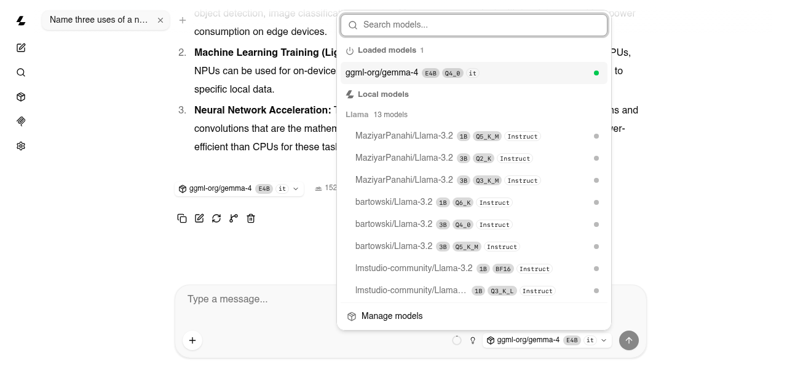

# artlite-server

Serves GGUF models as llama.cpp's `llama-server` does: an OpenAI-compatible API with llama-server's own routes and
fields, so that clients written for either work unchanged, and a web chat at `/`. With `-m` it serves that model;
without, every model of the models directory, loaded when the web chat's model picker or a request asks for it
([router mode](#several-models-router-mode)).

```bash
artlite-server -m ggml-org/gemma-4-E4B-it-GGUF/gemma-4-E4B-it-Q4_0.gguf -rea on    # then open http://127.0.0.1:8080
artlite-server                                                                      # the models directory's models
```

<picture>
  <source media="(prefers-color-scheme: dark)" srcset="images/server-dark.png">
  
</picture>

```bash
curl http://127.0.0.1:8080/v1/chat/completions -H "Content-Type: application/json" \
    -d '{"messages": [{"role": "user", "content": "Factorize x^2 + x - 6"}]}'
```

## API

| route | |
|---|---|
| `/v1/chat/completions` | chat, streamed or not, with `reasoning_content`, tool calls, `timings`, `prompt_progress`, `usage` |
| `/v1/messages`, `/v1/messages/count_tokens` | Anthropic's Messages API ([agents](#agents)) |
| `/v1/responses`, `/v1/responses/input_tokens` | OpenAI's Responses API ([agents](#agents)) |
| `/v1/completions`, `/completion` | raw prompts (OpenAI's and llama-server's shapes) |
| `/v1/models`, `/props`, `/health`, `/slots` | the model, the server's settings, its state |
| `/tokenize`, `/detokenize`, `/apply-template` | the model's tokenizer and chat template |

Sampling has the repetition, presence and frequency penalties, the temperature, top-k, top-p and min-p. The other
sampler fields (DRY, XTC, typical-p, mirostat, ...) are accepted and ignored, and logged when not neutral: the web UI's
settings for them have no effect.
Images (a model with `--mmproj`: [MiniCPM-V 4.7](models/qwen35.md#images-minicpm-v-47)) come as a chat message's
`image_url` parts of data URIs, as llama-server takes them; the web UI attaches them. Not provided: embeddings,
reranking, infill, `/metrics`, LoRA, model downloads; their routes answer 501.

Tool calls (OpenAI's function calling): a request's `tools` go to the model's chat template, and the calls the model
writes come back as `message.tool_calls` (streamed: `delta.tool_calls`, a call's id and name first, then its
arguments) with `finish_reason: tool_calls`; the results go back as `role: tool` messages. Qwen3.5 / 3.6 / 3.8,
MiniCPM-V 4.7 and Occamy (Qwen's XML calls), Gemma 4 and Llama 3.1 / 3.2 have them; a template without tools (Llama
3.2 1B Q3_K_L's file) ignores them. `tool_choice` takes `auto`, `none` (the tools stay in the prompt, nothing is
parsed), `required` and a named function (the answer begins with the call, after the model's thought; a named
function's call is the only one), and `parallel_tool_calls: false` ends the answer after its first call. A call's
name is always one of the request's functions: while the model writes it, only the tokens that spell one can come
(with `required` where no function fits, the model calls the closest one instead of inventing a name). The arguments
are not constrained by a grammar: a call the model writes malformed stays text, and a string argument whose schema
allows no string becomes the value it encodes (Llama 3.1 quotes numbers and lists).

## Agents

Coding agents and other clients that call tools use the API they speak: chat completions (opencode, Open WebUI, the
web chat), Anthropic's Messages API at `/v1/messages` (Claude Code, the Anthropic SDKs) or OpenAI's Responses API at
`/v1/responses` (Codex CLI, the OpenAI Agents SDK). All three run as the same chat request: tool calls, thoughts and
the prompt cache work alike.

```bash
artlite-server -m lmstudio-community/Qwen3.6-35B-A3B-GGUF/Qwen3.6-35B-A3B-Q4_K_M.gguf -rea on -c 131072
ANTHROPIC_BASE_URL=http://127.0.0.1:8080 ANTHROPIC_AUTH_TOKEN=none claude          # Claude Code
codex -c model_provider=artlite -c 'model_providers.artlite={name="artlite", base_url="http://127.0.0.1:8080/v1", wire_api="responses"}'
```

- Messages API: `system`, the blocks `text`, `image` (base64), `thinking`, `tool_use` and `tool_result`, `tools`,
  `tool_choice`, `stop_sequences`, and Anthropic's event stream. `thinking` turns the model's thought on (`enabled`,
  `adaptive`) or off (`disabled`; without it, `-rea` decides); its budget is not enforced. A prompt longer than the
  context answers "prompt is too long: N tokens > M maximum", which Claude Code acts on.
- Responses API: `instructions`, the items `message`, `reasoning`, `function_call` and `function_call_output`,
  function tools (others, such as `web_search`, are left out), `tool_choice`, `reasoning.effort` (`none`: no
  thought), `max_output_tokens`, and OpenAI's event stream. `previous_response_id` continues one of the last 1024
  responses the server keeps (not those with `store: false`); `GET` and `DELETE /v1/responses/{id}` read and drop
  one. A prompt longer than the context fails with the code `context_length_exceeded`.
- On every route a `developer` message is a system message, and where a template takes a system message only first
  (Qwen's), the later ones become user messages: Claude Code and Codex send them during a conversation.
- Agents copy their context (an edit's old text, a file they rewrite, a command again): generation takes draft tokens
  from it ([artlite-cli](cli.md#text)), so on recorded agent sessions Qwen3.6-27B, Qwen3.5-9B and Llama 3.1 8B generate
  1.46-1.52x faster and MiniCPM-V 1.25x (Qwen3.6-35B-A3B and Gemma 4 guess with their drafters: +0-4% more).

## Web chat

llama.cpp's own web UI (MIT license, copyright The ggml authors), prebuilt, pinned by build and checksum, downloaded
on the first start into the build cache (later starts need no network). `--path DIR` serves another build, `--no-ui`
none.

## Requests

With `-m`, the model loads after the server starts; until then the API answers 503 `Loading model`, which the UI
retries. A model's requests run one at a time, in arrival order; a waiting stream gets pings. A client that goes away, the UI's Stop
button and the shutdown stop a request at its next token or prompt chunk.

A chat's next turn continues from the KV cache: the server keeps the prefix a prompt shares with the cached tokens,
rounded down to where a prefill chunk can start, and runs the rest. Other conversations stay in host RAM, as in
llama-server (`--cache-ram`: 8 GiB by default, or half of the RAM left once the model is loaded where that is less):
when a request continues one of them (an agent's subagent, a title request, another chat in the web UI), its cache is
copied back to the NPU (~15 GB/s: 30-45 ms for 32K positions of the 35B-A3B) instead of running its prompt again. The
Qwen models' Gated DeltaNet states cannot go back, so for them the server saves the states (checkpoints,
`--ctx-checkpoints`; Qwen3.6-35B-A3B: 80 MB, a few milliseconds each) at the end of each prompt and where its first
user message begins: a prompt continues from the latest one it shares (the client's own rendering of the last answer,
another answer to the same prompt), and a new conversation with the same system prompt and tools from the second. The
earlier answers keep their thoughts in the prompt, as llama-server does (`--reasoning-preserve`, on by default, where
the template can: Qwen3.6 / 3.8, Occamy, Gemma 4), so a turn extends the last one when the client sends the thoughts
back (`reasoning_content`, as the web UI does). Where they are dropped (Qwen3.5's and MiniCPM-V's templates,
`--no-reasoning-preserve`), the next user message renders the last answer from its start otherwise: the server also
saves the state where each prompt's last message begins, and a turn continues from there. A request's
`cache_prompt: false` starts from an empty cache.

## Several models (router mode)

Without `-m`, artlite-server serves the models of a directory, as llama-server's router mode does: the web chat's
model picker lists them, a request's `model` names one, and a model loads when a request asks for it.

```bash
artlite-server                                   # the models of ARTLITE_MODELS_DIR (default ~/.artlite/models)
artlite-server --models-dir DIR --models-max 2   # another directory, two models loaded at a time
```

<picture>
  <source media="(prefers-color-scheme: dark)" srcset="images/server-models-dark.png">
  
</picture>

- **Models.** Each GGUF file of the directory that Artlite runs, named `<account>/<repository>:<quantization>`
  (`lmstudio-community/Llama-3.2-1B-Instruct-GGUF:Q4_0`); its path in the directory, as `-m` takes it, names it too.
  Files Artlite does not run (another architecture, tensor types without kernels) are skipped with a log line that
  says why. Drafters (`mtp-`, `<name>-mtp-`) and vision encoders are not models of their own: Gemma 4 and the
  qwen35moe models (Qwen3.6 35B-A3B, Occamy 1.0) find their drafters, and MiniCPM-V 4.7 gets the `mmproj` file of its
  directory (`mmproj-model-f16.gguf` before the 4x one).
- **Loading.** A request for a model that is not loaded loads it and waits. `--models-max` models (default 1) are
  loaded at a time: a load first unloads the least recently used model that has no request running, or waits for
  one, so a model is never unloaded under a request. Each model runs in a server process of its own, with the
  command line's model options (`-c`, `-rea`, `--temp`, `--kv-k`, ...); unloading ends that process, which gives all
  its memory back. One process is kept started ahead, so a load does not wait for Python to start (~1.5 s).
- **API.** `GET /v1/models` lists every model with its status: `unloaded` (`failed` and the reason when its last load
  failed), `loading`, `loaded`; `?reload=1` reads the directory again, and a running model whose file changed
  unloads. `POST /models/load` and `/models/unload` take `{"model": ...}` (an unload cancels the model's running
  request); `GET /models/sse` streams the status changes. `/props` describes the router (`role: router`);
  `/props?model=`, `/slots?model=` and the requests go to the model they name, or without a name to the one model
  loaded; `?autoload=false` does not load it.

`--models-preset FILE` sets options per model and adds models from elsewhere, in llama-server's INI format:

```ini
[*]                                        ; every model
ctx-size = 8192

[openbmb/MiniCPM-V-4.7-1B-gguf:Q4_K_M]      ; one model, by its name
mmproj = openbmb/MiniCPM-V-4.7-1B-gguf/mmproj-model-f16-4x.gguf
max-slices = 36
load-on-startup = true

[my-llama]                                 ; a model of its own, from anywhere
model = /path/to/Llama-3.2-3B-Instruct-Q4_K_M.gguf
alias = llama
```

Keys are the options' long names without dashes (`ctx-size`), their short ones (`c`) or their environment variables
(`ARTLITE_ARG_CTX_SIZE`); switches take `true` or `false` (`no-prefill = true`, `warmup = false`). An empty `mmproj`
turns a vision encoder off, `alias` adds names (comma-separated), `load-on-startup` loads the model when the server
starts. A model's option comes from the command line, else its section, else `[*]`.

## Options

Each option also reads `ARTLITE_ARG_<NAME>`, the long option's name in upper case with dashes as underscores
(`ARTLITE_ARG_CTX_SIZE=65536`); the command line overrides it. `artlite-server --help` lists every variable.

| option | |
|---|---|
| `-m FILE`, `--model` | the GGUF file (as [artlite-cli](cli.md)'s `-m`); without: router mode |
| `-a NAME`, `--alias` | the model's id in the API (default: the file name) |

Router mode (without `-m`):

| option | |
|---|---|
| `--models-dir DIR` | serve the models of this directory (default: `ARTLITE_MODELS_DIR`, `~/.artlite/models`) |
| `--models-preset FILE` | models' options and more models ([above](#several-models-router-mode)) |
| `--models-max N` | models loaded at a time, 0: any number (default 1) |
| `--models-autoload`, `--no-models-autoload` | a request loads the model it names (default on; a request's `?autoload=false`: not) |

Server:

| option | |
|---|---|
| `--host`, `--port` | the address to listen on (default 127.0.0.1:8080) |
| `--api-key KEYS`, `--api-key-file FILE` | keys clients must send (`Authorization: Bearer` or `X-Api-Key`): comma-separated, or one per line in a file (`#` starts a comment) |
| `--cors-origins LIST` | origins allowed by CORS, comma-separated (default `*`) |
| `--path DIR`, `--no-ui` | serve the web UI from this directory; no web UI |
| `-to S`, `--timeout` | seconds an idle connection is kept open (default 3600) |
| `--sse-ping-interval S` | seconds between pings while a stream waits for the NPU (default 30) |
| `--slots`, `--no-slots` | the `/slots` endpoint (default on) |

Generation:

| option | |
|---|---|
| `-c N`, `--ctx-size` | KV cache positions, rounded up to a power of two >= 4096 (default 0: 32768, at most the model's context) |
| `-n N`, `--n-predict` | tokens to generate when a request does not say (default -1: until an end-of-sequence token or a full KV cache) |
| `-np N`, `--parallel` | sequences at a time (1 only: the NPU runs one) |
| `--cache-prompt`, `--no-cache-prompt` | continue from the prefix a prompt shares with the cached tokens (default on) |
| `-cram N`, `--cache-ram` | MiB of host RAM for the prompt cache: the conversations it saves and the checkpoints (default 8192, at most half of the RAM still available once the model is loaded; -1: no limit, 0: none saved) |
| `-ctxcp N`, `--ctx-checkpoints` | checkpoints per conversation at most (Qwen3.5 / 3.6 / 3.8, Occamy, MiniCPM-V; default 32) |
| `--lookup`, `--no-lookup` | draft tokens from the prompt in the generation's steps ([artlite-cli](cli.md#text)'s; default on) |
| `--temp`, `--top-k`, `--top-p`, `--min-p`, `--repeat-penalty`, `--repeat-last-n`, `--presence-penalty`, `--frequency-penalty` | sampling defaults (default: the model's), as [artlite-cli](cli.md)'s |
| `-s SEED`, `--seed` | sampling seed (default -1: random per request) |
| `-rea on\|off\|auto`, `--reasoning` | let a model with a thinking mode think first (auto: when it has one; default off); a request's `chat_template_kwargs.enable_thinking` and the UI's toggle override it |
| `--reasoning-format auto\|deepseek\|none` | thoughts in `reasoning_content` (auto, deepseek) or in `content` (none) (default auto) |
| `--reasoning-preserve`, `--no-reasoning-preserve` | earlier answers keep their thoughts in the prompt where the template can (the templates' `preserve_thinking`; default on); a request's `chat_template_kwargs.preserve_reasoning` (or `preserve_thinking`) overrides it |
| `--chat-template-kwargs JSON` | chat template variables, under each request's own (`enable_thinking`, `preserve_reasoning`) |

NPU:

| option | |
|---|---|
| `--no-prefill` | run prompts as decode steps |
| `--kv-k single\|hilo` | the KV cache's K precision (Llama, Gemma 4), as [artlite-cli](cli.md)'s |
| `--warmup`, `--no-warmup` | run one token after loading (default on) |

Images:

| option | |
|---|---|
| `--mmproj FILE` | the vision encoder's file (MiniCPM-V 4.7: `mmproj-model-f16.gguf`): images in chat messages |
| `--max-slices N` | an image's slices at most (default: the mmproj's, 9; the model card uses 36) |

Logging:

| option | |
|---|---|
| `-v`, `--verbose` | debug messages and every HTTP request |
| `--log-file FILE` | also write the log to this file |
